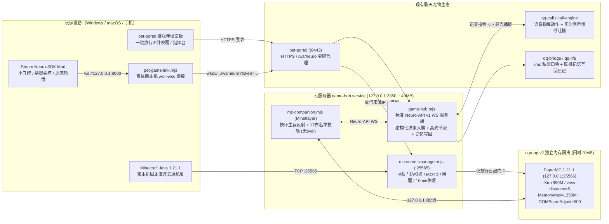

# Game Companion Module — 平台无关统一游戏伴侣（Minecraft 1.21.1 自休眠云私服 + Neuro-API Steam 直连）

> **模块定位**：让聊天宠物拥有真正可玩的「游戏伴侣」能力——**一套平台无关的 Neuro-API v1 内核**同时驱动 **Minecraft Java 1.21.1 具身联机队友** 与 **Steam 开源 Mod 游戏（如小丑牌 Balatro / 杀戮尖塔 / 恶魔轮盘 / Among Us 等）**，并与现有 **QQ 全双工实时语音通话（`call-engine`）**、**HTTPS 管理台（`pet-portal`）** 和 **长期记忆/日记系统** 双向打通。
> **内存友好**：专针对 4G 轻量云服务器设计——MC 私服平时**彻底休眠占 0 MB 内存**，进服或网页一键唤醒，运行期被内核 cgroup v2 硬锁在 `MemoryMax=1350M` + `OOMScoreAdjust=500`，绝不拖垮 QQ / DSH / 实时通话；最后一位玩家离线 10 分钟后自动存档关服。

---

## 1. 总体解耦架构



### 核心模板文件清单

| 文件 | 职责 | 平台耦合度 |
| --- | --- | --- |
| [`templates/game-hub.mjs`](./templates/game-hub.mjs) | 统一游戏大脑 & 标准 `VedalAI/neuro-sdk` v1 WebSocket 服务端（支持 `startup` / `context` / `actions/register` / `actions/unregister` / `actions/force` / `action` / `action/result` + `actions/reregister_all`，严格 JSON Schema 校验、高光语音推送、对局摘要写回记忆） | **零耦合** |
| [`templates/mc-server-manager.mjs`](./templates/mc-server-manager.mjs) | 零闲置内存 MC 1.21.1 自休眠托管器 & TCP 敲门代理（隐藏 PaperMC 至 `127.0.0.1:25566`、原生 VarInt MOTD 响应、Portal IP 敲门防公网扫描与熊孩子、systemd cgroup v2 内存硬隔离、10 分钟无人自动 `/save-all` + `/stop`） | 仅管理 PaperMC |
| [`templates/mc-companion.mjs`](./templates/mc-companion.mjs) | 基于 `mineflayer` (`1.21.1`) 的标准 Neuro-API 队友客户端（中英文方块/物品别名映射、快环自保反射、17 个白名单安全技能、严禁 LLM 动态 `eval`、每步寻路/挖掘严格超时防卡死） | 仅适配 MC 1.21.1 |
| [`templates/pet-game-link.mjs`](./templates/pet-game-link.mjs) | 跨平台（Windows/macOS/Linux）零依赖本机桥接器（纯 Node 内置模块，免 `npm install`），将本机明文 `ws://127.0.0.1:8000` 安全 TLS 转发至云端 `wss://<host>:8443/ws/neuro?token=...` | **零耦合** |

---

## 2. 部署与环境初始化（4G 轻量云安全配置 SOP）

### Step 1：安装 Java 21 Headless 与 2G 兜底 Swapfile
```bash
# OpenCloudOS / RHEL 9 系列（其他发行版可用 java-21-openjdk-headless）
# 注：TencentKonaJDK 21 版本号含 `-ga` 后缀，mc-server-manager.mjs 已内置 `-DPaper.IgnoreJavaVersion=true` 自动兼容
dnf install -y java-21-konajdk-headless

# 补充 2G 磁盘兜底 swapfile（优先级 10 < zram 100，平时 0 使用，仅作防 OOM 安全气囊）
fallocate -l 2G /swapfile && chmod 600 /swapfile && mkswap /swapfile
swapon -p 10 /swapfile
echo "/swapfile none swap sw,pri=10 0 0" >> /etc/fstab
```

### Step 2：下载 PaperMC 1.21.1 核心与安装 Mineflayer 依赖
```bash
mkdir -p /opt/mc-server /opt/game-hub

# 从 PaperMC Fill v3 API 获取 1.21.1 最新构建并下载至 /opt/mc-server/paper-1.21.1.jar
BUILD_URL=$(curl -fsSL -H "User-Agent: dsh-pet-mc/1.0" \
  "https://fill.papermc.io/v3/projects/paper/versions/1.21.1/builds" \
  | python3 -c 'import sys,json; print(json.load(sys.stdin)[0]["downloads"]["server:default"]["url"])')
curl -fSL -C - -H "User-Agent: dsh-pet-mc/1.0" -o /opt/mc-server/paper-1.21.1.jar "$BUILD_URL"

# 安装 ViaVersion（放进 /opt/mc-server/plugins/，支持 Minecraft 1.21.1 ~ 26.3+ 新版客户端直连，无需降级客户端）
mkdir -p /opt/mc-server/plugins
# 从 Modrinth / Hangar 下载最新 ViaVersion >= 5.12.x 放入 plugins/

# 安装游戏网关与 Mineflayer 依赖（Node.js 18/20/22/24 均原生支持）
cd /opt/game-hub
npm init -y && npm pkg set type=module
npm install --no-audit --no-fund ws mineflayer mineflayer-pathfinder vec3
```

### Step 3：配置 systemd 守护服务与放行端口
1. 将 `templates/{game-hub,mc-server-manager,mc-companion,pet-game-link}.mjs` 复制到 `/opt/game-hub/`，将最新版 `call-engine.mjs` / `qq-call-adapter.mjs` / `pet-portal.mjs` / `pet-game-link.mjs` 同步到 `/opt/qq-bridge/src/`。
2. 创建 `/etc/systemd/system/game-hub.service`：
   ```ini
   [Unit]
   Description=game-hub (Unified Neuro-API Game Companion & Auto-Sleep MC 1.21.1 Manager)
   After=network-online.target qq-bridge.service qq-call.service
   Wants=qq-bridge.service qq-call.service

   [Service]
   Type=simple
   User=root
   WorkingDirectory=/opt/game-hub
   Environment=NODE_OPTIONS=--max-old-space-size=256
   ExecStart=/usr/local/bin/node /opt/game-hub/game-hub.mjs
   MemoryMax=384M
   Restart=always
   RestartSec=3

   [Install]
   WantedBy=multi-user.target
   ```
3. 启动并刷新网关：
   ```bash
   systemctl daemon-reload
   systemctl enable --now game-hub
   systemctl restart qq-call pet-portal
   ```
4. 在云厂商控制台安全组放行一条入站规则：**`TCP 25565`**（供你 Windows 电脑连入 MC 敲门代理；PaperMC 本体仅监听 `127.0.0.1:25566`，公网不可见）。

---

## 3. Windows 玩家 3 分钟 MC 1.21.1 联机上手指南

> 本机**不需要**安装 Node.js 或运行任何脚本！

1. **安装 Windows Minecraft Java 启动器**（任选其一）：
   - 有微软正版账号：微软商店/官网下载 **Minecraft Launcher**，或开源轻量的 **Prism Launcher**；
   - 想先体验本地离线角色：下载开源免费的 **HMCL**（`https://hmcl.huangyuhui.net`）或 **PCL2**，在启动器里新建一个英文/拼音离线角色（如 `PlayerOne`），选择下载并启动 **`Java 1.21.1`（原版即可，无需装 Mod）**。
2. **一键敲门并唤醒云私服**：
   - 在 Windows 浏览器打开你的管理台 `https://<服务器IP或域名>:8443` → 切换到 **「🎮 游戏伴侣」** 标签页；
   - 点击 **「🔓 放行当前 IP 并唤醒 MC」**（自动把你这台 Windows 电脑的公网 IP 放行 24 小时，并在约 15 秒内启动世界 + 召唤 `xiaojingjing` 上线）。
3. **进服并开麦连麦**：
   - 在 Minecraft 里点「多人游戏」→「添加服务器」→ 服务器地址填 `<服务器IP或域名>:25565` → 加入游戏；
   - 进服就能看到小鲸鲸站在世界里，同时给小鲸鲸打一通 **QQ 实时语音电话**，边玩边直接开口指挥她（如“跟我走”“贴身保护我”“去砍点木头”“把铁矿扔给我”“天黑了搭个小屋”）；不打电话时也可以直接在 MC 聊天框按 `T` 打字和她对话！
4. **玩完直接退出**：退出游戏满 10 分钟，服务器会自动 `/save-all` 保存世界并休眠归零内存；也可在管理台随时手动点「🌙 存档并休眠关服」。

---

## 4. 路线 C：Windows 直通 Steam 游戏（小丑牌 Balatro / 杀戮尖塔 / 恶魔轮盘 / Among Us）

本模块的 `game-hub.mjs` 与 `pet-portal.mjs`（`/ws/neuro`）已原生兼容 **`VedalAI/neuro-sdk`** 协议，且独立签发可随时重置的 **Game Link Token**（绝不暴露管理密码）。

### 通用 2 步接入流程（以 Windows 上玩 **小丑牌 Balatro** 为例）
1. **在 Windows 启动本机桥接器**（需本机有 Node.js 18+，无需 `npm install`）：
   - 在 `pet-portal` →「🎮 游戏伴侣」页点击 **「⬇️ 下载本机桥接器 (pet-game-link.mjs)」**，并复制页面自动生成的 PowerShell 命令：
     ```powershell
     node pet-game-link.mjs --portal https://<服务器IP或域名>:8443 --token <GameToken> --insecure
     ```
   - 保持该窗口开启，本机 `ws://127.0.0.1:8000` 即自动加密桥接到云端小鲸鲸。
2. **给 Steam 游戏安装对应开源 Neuro-SDK Mod**：
   - **小丑牌（Balatro）**：安装标准开源 Mod loader **Lovely** + **Steamodded (`smods`)** + 开源 Neuro-API 集成 Mod（如社区 `Neuratro` / Neuro-SDK Lua 桥接，指向默认 `ws://127.0.0.1:8000`）；
   - **其他零改动兼容游戏**：*杀戮尖塔 Slay the Spire (1/2)*、*恶魔轮盘 Buckshot Roulette*、*邪恶冥刻 Inscryption*、*Among Us*（`neuro-amongus` 私人房联机）——所有指向 `ws://127.0.0.1:8000` 的 Neuro-SDK Mod 均开箱即连！
   - 连上后，管理台「游戏伴侣」页会自动显示当前已连接的 Steam 游戏名称、已注册动作列表与每回合决策记录；同时开着 QQ 实时语音电话还能边听她吐槽手牌边口头指导她出牌！

---

## 5. 安全边界清单

- **PaperMC 隐藏回环**：`server-ip=127.0.0.1`、`server-port=25566`，绝不裸露 `online-mode=false` 服务端到公网；外层 `:25565` 代理静默丢弃未通过 HTTPS Portal 敲门的陌生扫描 IP。
- **零任意代码执行**：`mc-companion.mjs` 仅暴露 17 个白名单原子技能并做 JSON Schema 清洗与超时熔断，绝不允许 LLM 生成或 `eval` 任意脚本。
- **内核级内存防拖垮**：`game-hub.service` 限 `MemoryMax=384M`；PaperMC 经 `systemd-run --scope` 独立限制在 `MemoryHigh=1100M` / `MemoryMax=1350M` + `OOMScoreAdjust=500`，确保极端情况下优先回收 MC，绝不影响 QQ 与语音服务。
- **Steam 桥接最小权限**：`/ws/neuro` 使用独立可随时旋转的 `Game Link Token`（`state/game-link-token`，权限 `0600`），与管理员登录态和内部 `console-token` 彻底隔离。
