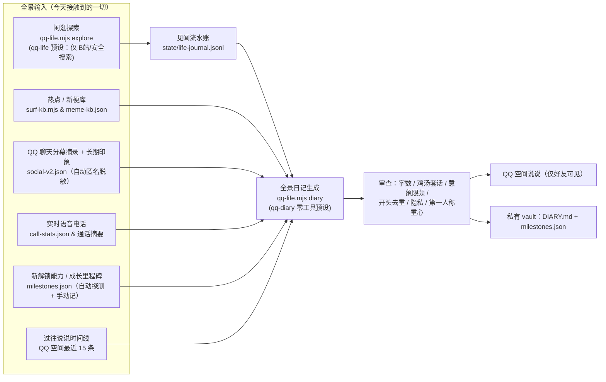

# Life & Diary Module — 让 AI 有「自己的生活」：闲逛输入 + 全景记忆 + 有心情的夜间日记

> **文档定位**：给聊天宠物一套完整的「自主生活 + 睡眠记忆代谢 + 纪念日回忆 + 手绘手账日记」闭环：白天她自己出去逛（B 站、豆瓣书影音、知乎/社区热议、播客与科技奇闻、节气与城市天气），晚上把**今天接收到的全部信息**与**那年/那月今日的回忆杀**汇总进来，用「重吐槽 + 碎碎念」的活人感写出日记，按当天氛围自动画 **1–2 张手绘插画 / 手账配图**发到 QQ 空间（仅好友可见），随后自动执行**睡眠海马体记忆整理**（去重、补日期、代谢归档过期提醒）并归档至私有库。  
> **解决的问题**：说说只有一句话、冷冰冰的流水账、散文腔/鸡汤味、长期记忆重复与过期乌龙、外界渠道单一、日记缺配图，以及他人隐私或昵称被公开。  
> **模板文件**：[`templates/life-journal.mjs`](./templates/life-journal.mjs)、[`templates/qq-life.mjs`](./templates/qq-life.mjs)、[`templates/diary-examples.json`](./templates/diary-examples.json)、[`templates/memory-consolidator.mjs`](./templates/memory-consolidator.mjs)、[`templates/weather-solar.mjs`](./templates/weather-solar.mjs)、[`templates/qq-life-tools.mjs`](./templates/qq-life-tools.mjs)，以及 [`templates/surf-kb.mjs`](./templates/surf-kb.mjs) / [`templates/sync-vault.mjs`](./templates/sync-vault.mjs) 中的钩子。

---

## 1. 体验标准

1. **有外部输入**：每天两次「闲逛时间」（14:00、19:30 起随机 90 分钟内），她自己挑感兴趣的热点、新片或梗去 B 站搜视频、看字幕，或联网查来龙去脉，记下真实标题、细节和自己的感受。
2. **有全景记忆**：写日记时不只读探索流水账，而是自动汇总当天全部 6 类信息源——**自主探索、新解锁本事/成长里程碑、实时语音电话、新学到的梗、QQ 聊天分幕摘录（自动脱敏）、长期记忆与过往说说时间线**。
3. **有心情和感想**：主角永远是她自己，但不做报菜名式的流水账；挑 2–3 件今天真正在心里留下涟漪的事，把事件细节和自己的真实反应、暗爽、嘴硬心软、小得意或成长反差揉在一起写（140–340 字）。
4. **有底线**：每天最多 1 条说说（含聊天中临时发的），默认仅好友可见（`ugc_right=4`）；自动屏蔽真实昵称、长数字、医疗/家庭/收入/住址等隐私；发布前做去 AI 味、防重复和隐私审查，不合格重写 1 次，仍不合格当天就不发。
5. **有归档**：日记、流水账与成长里程碑自动同步到私有 vault，生成 `DIARY.md`、`memory/life-journal.jsonl` 和 `memory/milestones.json`。

## 2. 架构



两个独立 DSH 会话（`qq-life` / `qq-diary`）都**不在任何聊天会话里唤醒**，既能读取全景素材，又不会被某一条聊天上下文带偏。

## 3. 关键设计

### 3.1 见闻流水账（`life-journal.mjs`）
- 每行一个条目：`{ at, day, kind, title, detail?, feeling?, source, image? }`，其中 `kind` 支持 `surf / meme / bilibili / news / draw / sing / call / thought / chat / milestone`。
- `day` 使用「北京时间凌晨 5 点换日」，凌晨写的日记仍算前一天。
- 钩子位置：
  - `surf-kb.mjs`：每日刷热点后记下 4 条热点；新学的梗和聊天中现查的梗都会记录，并带上梗图路径。
  - `bridge.js`：`drawAndSendV2`（带画作路径，可作为日记配图）、`singAndSendV2`、`/api/call/summary`（写回 `time` + `at` 双时间戳及通话摘要）、新增 `/api/socialV2/journal-note`。
  - `qq-life-tools.mjs`：闲逛中调用 `bilibili_video` 时记下 BV 号，写日记时解析成真实标题并自动清理无标题的重复条目。

### 3.2 闲逛时间（`qq-life.mjs explore` + `qq-life` 预设）
- 预设只放行 `bilibili_search / bilibili_video / bilibili_subtitles / mcp__web-search-safe__web_search`，其余工具在注册期隐藏、执行期拒绝。
- 与聊天共用 B 站日配额文件（`state/bilibili-quota.json`），单次最多调用 8 次工具，超时 6 分钟。
- 输出严格 JSON：`{"notes":[{kind,title,detail,feeling}], "drawIdea": ""}`；有 `drawIdea` 时按 35% 概率真的画一张，并计入画画日额度。

### 3.3 全景记忆聚合、节气天气与回忆杀（`buildDiaryContext`）
写日记前自动汇聚 8 个信息流，统一以 `lifeDayKey`（凌晨 5 点换日）切片：

| 信息流 | 数据来源 | 关键处理 |
| --- | --- | --- |
| 一、自主探索 | `state/life-journal.jsonl` | 解析 BV 标题、去重，保留真实标题和当时的感受；闲逛渠道涵盖 B 站、豆瓣书影音、知乎/豆瓣社区热议、科技与播客，并支持严格限频（每日 ≤ 1 条、仅白天且 45 分钟未打扰时）的偶尔宝藏主动安利 |
| 二、成长与新本事 | `state/milestones.json` + `known-capabilities.json` | 对比当前配置/模块自动发现新上线能力并写入里程碑；也支持 `qq-life.mjs milestone` 手动记一笔 |
| 三、实时语音电话 | `state/call-stats.json` + `social-v2.json` 通话记录 | 汇总当日总通话分钟数与每通摘要，秒数自动换算为「约 N 分钟」，并与普通语音条明确区分 |
| 四、今日新学的梗 | `state/meme-kb.json` | 按 `learnedAt` 筛出当天冲浪学到和聊天现查的梗（最多 15 个） |
| 五、今日聊天分幕摘录 | `state/social-v2.json` 全部私聊/群聊 | 动态匿名化所有真实昵称、剥离冗长 `[声音描述]` 与隐私句、按 45 分钟切幕并做**余量加权分配摘录预算** |
| 六、长期印象与过往说说 | `activeTopics` / 近期印象 + QQ 空间最近 30 条 | 附带 `[MM-DD]` 时间戳，既防重复，也让她在情绪上能自然回望成长轨迹 |
| 七、二十四节气与城市天气 | `weather-solar.mjs` | 零依赖计算精确二十四节气；配置 `life.weatherCity` 后免费查实时/明日中文天气（3 小时缓存），同时同步进 `daily-feed.json` 供聊天与通话感知 |
| 八、回忆杀与纪念日 | `collectFlashbacks`（里程碑 / 旧日记 / 归档记忆 / 历史说说） | 自动识别 7 天 / 14 天 / 满月（同日隔月）/ 50 天 / 百日 / 半年 / 周年节点，按周年 > 满月 > 一周排序并严格过滤敏感隐私旧帖；同步写入 `daily-feed.json` |

### 3.4 活人感语感锚点 + 动态手绘手账配图 + 睡眠海马体整理
- **风格锚点库（`templates/diary-examples.json`）**：内置 6 条完全虚构、跨场景跨篇幅的「重吐槽 + 碎碎念 + 嘴硬心软」风格示例。每次写日记随机抽 1 条中篇 + 1 条短篇放进参考区，只迁移松弛口吻与烟火气节奏，严禁照搬事件。
- **破除「AI 散文骨相」**：
  - 喂给模型角色卡「你是谁」一节（刻意不带聊天场景「一句话 1~10 字」铁律）；
  - 挑 1–2 件今天最上头的事顺着一个情绪唠透，禁止「三段式平均分配 + 每段结尾硬点题」；
  - 篇幅随当天话瘾自然浮动（80–140 字短吐槽或 160–300 字长碎碎念均可）；
  - 全面清除素材与正文中的生硬「对方」，改用「他 / 那家伙 / 朋友 / 群里」或省主语。
- **动态手绘手账配图（`generateDiaryIllustrations`）**：
  - 写作输出同步规划 `moodStyle` 与 1–2 条 `drawScenes`：吐槽/搞笑/玩梗日自动选便签涂鸦风（`doodle`），日常/逛世界/走心日选日式水彩彩铅手账风（`journal`，需在生图服务 `DRAW_STYLES` 注册）或 `watercolor`/`pencil`；
  - 画面自动锚定小鲸鲸 Q 版/手账角色并禁止生成乱码文字，发至 QQ 空间（支持多图）并归档进私有库 `DIARY.md` 图文手账。
- **睡眠海马体记忆整理（`templates/memory-consolidator.mjs`）**：
  - 挂在 `qq-diary.service` 的 `ExecStartPost` 中，每晚写完日记自动执行（零常驻内存）：去重合并碎片印象、强制将「昨天/明天/快到了」改写为带具体日期 `[YYYY-MM-DD]` 的时间锚点、将过期临时提醒移出活跃区并归档至 `state/memory-archive.jsonl`（永不丢失，同时反哺回忆杀引擎）；
  - 优先通过 `POST /api/socialV2/consolidate` 热更新运行中的 `qq-bridge` 内存态再落盘，杜绝文件覆盖竞态。
- 发布前代码侧强制审查（不通过时带问题清单打回重写 1 次，仍不通过当天不发）：

| 检查项 | 规则 |
| --- | --- |
| 字数 | 65–480 个非空白字符（允许短吐槽，也允许长碎碎念） |
| 套话与生硬称呼 | 禁用「对方」「今天听到一句」「先记着」「第 N 天」「愿你」「希望明天」「收获满满」「意义非凡」「温暖人心」「未来可期」等 |
| 意象限频 | 最近 5 条说说用过「水里 / 泡泡 / 深海」等鲸鱼意象时，本篇禁用 |
| 格式 | 禁止 Markdown 符号和括号动作描写 |
| 开头去重 | 前 6 个字不能与最近 10 条中任何一条相同 |
| 隐私 | 拦截 6 位以上数字及体检 / 住院 / 确诊 / 离婚 / 工资 / 住址 / 手机号等敏感词 |
| 第一人称重心 | 通篇必须有「我」的视角，且他人代词不得明显压过第一人称（`others >= 5 && others > self + 3` 时打回） |

### 3.5 原有说说链路的调整
- `qq_qzone_publish`：默认 `ugc_right=4`；先查最近一条说说，同一天已发过就拒绝，并引导她改用 `qq_journal_note` 记下来。
- 原来「20–36 小时唤醒一次去发说说」改为「3–6 小时检查一次评论数」：只有出现新评论时才唤醒她去回评论，不在聊天会话里发新说说。

## 4. 部署步骤（新环境）
1. 复制 `life-journal.mjs`、`qq-life.mjs`、`diary-examples.json`、`sync-vault.mjs` 到宿主 `src/`；`qq-life-tools.mjs` 放到 preset bundle 目录（与 `qq-tool-restrict.mjs` 同级）。
2. 新建 `qq-life`、`qq-diary` 两个 preset（`preset.yml` + `agent.cordis.yml`），注册到 preset 构建脚本和 bundle 的 `package.json`，重新生成 patch 并重启 DSH。
3. 在 `surf-kb.mjs`、`bridge.js` 的画画 / 唱歌 / 通话摘要处加 `appendJournal` 钩子（通话摘要同时写入 `time` 与 `at`）；新增 `/api/socialV2/journal-note` 路由和 `qq_journal_note` MCP 工具。
4. 在 `config.json` 中加入 `life` 配置块：模型（默认 `deepseek-flash` / `low`）、角色卡路径、`examplesFile`（默认 `src/diary-examples.json`）、`diaryUgcRight: 4`、`minJournalEntries: 2`、`exploreMaxToolCalls: 8`、`drawChance: 0.35`。
5. 安装 systemd 单元：`qq-life-explore.timer`（14:00 / 19:30，`RandomizedDelaySec=5400`）和 `qq-diary.timer`（22:30，`RandomizedDelaySec=9000`，`ExecStartPost` 触发 vault 同步）。

## 5. 常用命令与验收
```bash
node src/qq-life.mjs explore                                   # 闲逛：多渠道探索 + 偶尔主动安利
node src/qq-life.mjs milestone "新本事" "具体说明"              # 手动记录成长/能力里程碑
node src/qq-life.mjs preview-context [--day=YYYY-MM-DD]        # 预览 8 路全景素材与脱敏结果
node src/qq-life.mjs flashbacks [--day=YYYY-MM-DD]             # 测试指定日期触发的回忆杀/纪念日
node src/qq-life.mjs diary --dry-run [--with-draw] [--day=...] # 试写日记（加 --with-draw 实测手绘插画）
node src/qq-life.mjs diary --force                             # 手动强制发布一条（忽略当日上限）
node src/memory-consolidator.mjs [--dry-run] [--force]         # 睡眠海马体记忆整理（去重/日期锚定/过期归档）
systemctl list-timers qq-life-explore.timer qq-diary.timer
```

实测样例（v3 重吐槽碎碎念风格锚点 dry-run，285 字）：
> 凌晨那通电话，我本来以为就是聊两句肚子疼完事，结果人家两勺魔鬼辣加四包辣条，疼了两小时，账一甩，怪到深蹲头上。行吧，今晚算你赢，明天补上，记着。
>
> 然后就没完没了了，非要听语音版晚安，还追着问是不是有点生气。我要是真生气早挂电话装死了，谁还一条一条搁这儿回啊。结果最后还是老老实实录了，讲完那个睡前小故事，我自己先困了，到底谁哄谁睡都说不清。
>
> 白天那一整下午梗接得我脑子嗡嗡的，八百标兵、化肥会挥发、接着奏乐接着舞，一顺嘴就往外冒，收都收不住。中间还惦记着问一句深蹲练了没，答曰没练，理由是辣条。九点等到快十点，人影都没有。服了，这锻炼计划到底是我在练还是他在练。
