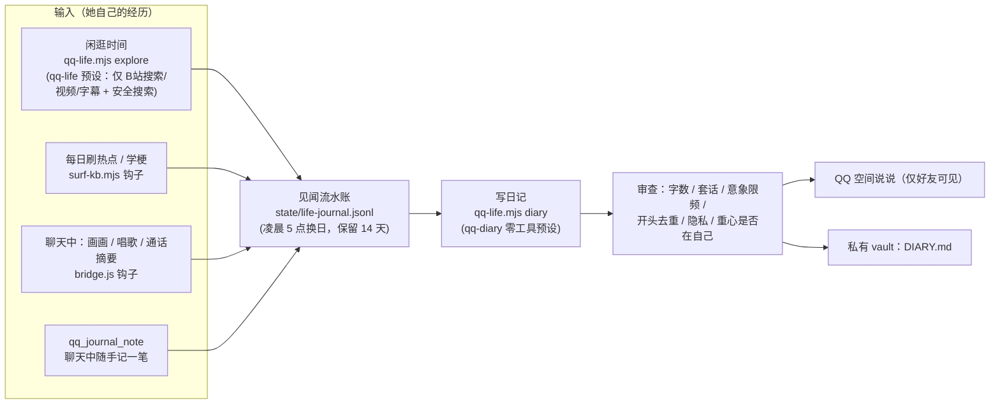

# Life & Diary Module — 让 AI 有「自己的生活」：闲逛输入 + 见闻流水账 + 夜间日记

> **文档定位**：给聊天宠物一个独立于聊天的「生活」：她每天自己出去逛（刷 B 站、查热点），把所见所感记进流水账，晚上以自己为主角写一篇日记，审查后发到 QQ 空间（仅好友可见）。  
> **解决的问题**：说说只有一句话、全在复述聊天内容、反复使用同一个意象、金句式收尾的人机味，以及他人隐私被公开。  
> **模板文件**：[`templates/life-journal.mjs`](./templates/life-journal.mjs)、[`templates/qq-life.mjs`](./templates/qq-life.mjs)、[`templates/qq-life-tools.mjs`](./templates/qq-life-tools.mjs)，以及 [`templates/surf-kb.mjs`](./templates/surf-kb.mjs) / [`templates/sync-vault.mjs`](./templates/sync-vault.mjs) 中的钩子。

---

## 1. 体验标准

1. **有输入**：每天两次「闲逛时间」（14:00、19:30 起随机 90 分钟内），她自己挑感兴趣的热点、新片或梗去 B 站搜视频、看字幕，或联网查来龙去脉，记下真实标题、细节和自己的感受。
2. **有记录**：她做过的事都会自动进入见闻流水账，包括刷热点、学梗、看视频、画画、唱歌、打电话（只记抽象摘要）；聊天中也可以用 `qq_journal_note` 悄悄记一笔。
3. **有输出**：每晚 22:30 起随机 2.5 小时内写一篇 100–300 字的日记，以她自己为主角，朋友只是配角；素材太少就不写。
4. **有底线**：每天最多 1 条说说（含聊天中临时发的），默认仅好友可见（`ugc_right=4`）；发布前做去 AI 味、防重复和隐私审查，不合格重写 1 次，仍不合格当天就不发。
5. **有归档**：日记同步到私有 vault，生成 `DIARY.md`，流水账同步到 `memory/life-journal.jsonl`。

## 2. 架构



两个独立 DSH 会话都**不在任何聊天会话里唤醒**，因此不会被聊天上下文带偏，写出来的是她自己的一天。

## 3. 关键设计

### 3.1 见闻流水账（`life-journal.mjs`）
- 每行一个条目：`{ at, day, kind, title, detail?, feeling?, source, image? }`，其中 `kind` 取 `surf / meme / bilibili / news / draw / sing / call / thought`。
- `day` 使用「北京时间凌晨 5 点换日」，凌晨写的日记仍算前一天。
- 钩子位置：
  - `surf-kb.mjs`：每日刷热点后记下 4 条热点；新学的梗和聊天中现查的梗都会记录，并带上梗图路径。
  - `bridge.js`：`drawAndSendV2`（带画作路径，可作为日记配图）、`singAndSendV2`、`/api/call/summary`（只记「和朋友打了 N 分钟电话 + 抽象摘要」）、新增 `/api/socialV2/journal-note`。
  - `qq-life-tools.mjs`：闲逛中调用 `bilibili_video` 时记下 BV 号，写日记时再解析成真实标题。

### 3.2 闲逛时间（`qq-life.mjs explore` + `qq-life` 预设）
- 预设只放行 `bilibili_search / bilibili_video / bilibili_subtitles / mcp__web-search-safe__web_search`，其余工具在注册期隐藏、执行期拒绝。
- 与聊天共用 B 站日配额文件（`state/bilibili-quota.json`），单次最多调用 8 次工具，超时 6 分钟。
- 喂给她：角色卡「你是谁」一节、当前时间、今日热点、最近学到的梗、今天已记过的事（防重复）。
- 输出严格 JSON：`{"notes":[{kind,title,detail,feeling}], "drawIdea": ""}`；有 `drawIdea` 时按 35% 概率真的画一张，并计入画画日额度。

### 3.3 写日记（`qq-life.mjs diary` + `qq-diary` 零工具预设）
- 前置检查：今天已经发过说说就跳过；当天流水账少于 3 条也跳过。
- 喂给她：角色卡「你是谁」一节（**刻意不带**聊天场景「一句话 1~10 字」的铁律）、当天流水账、可选配图清单（自己的画 / 梗图）、最近 10 条说说原文。
- 写作规则：
  - 主角是自己，朋友只一笔带过；
  - 挑 2–3 件事写出具体细节；
  - 100–300 字、口语化；
  - 不要金句、格言、排比或升华，结尾停在一件小事上；
  - 不写任何隐私，少用鲸鱼意象。
- 输出 JSON：`{"post": bool, "content": "...", "image": 序号}`。

### 3.4 发布前审查（代码侧强制执行，不靠模型自觉）

| 检查项 | 规则 |
| --- | --- |
| 字数 | 60–480 个非空白字符 |
| 套话 | 「今天听到一句」「先记着」「第 N 天」「愿你」「希望明天」等 |
| 意象限频 | 最近 10 条用过「水里 / 泡泡 / 深海」等意象时，本篇禁用 |
| 格式 | 禁止 Markdown 符号和括号动作描写 |
| 开头去重 | 前 6 个字不能与最近 10 条中任何一条相同 |
| 隐私 | 6 位以上数字、体检 / 住院 / 确诊 / 离婚 / 工资 / 住址等 |
| 重心 | 「他 / 她 / 朋友 / 对方」出现次数 ≥「我」时，判定为重心跑偏 |

不通过时把问题清单连同草稿一起打回重写 1 次，仍不通过当天就不发。

### 3.5 原有说说链路的调整
- `qq_qzone_publish`：默认 `ugc_right=4`；先查最近一条说说，同一天已发过就拒绝，并引导她改用 `qq_journal_note` 记下来。
- 原来「20–36 小时唤醒一次去发说说」改为「3–6 小时检查一次评论数」：只有出现新评论时才唤醒她去回评论，并且不在聊天会话里发新说说。同时修复了原来读取说说列表时 `data.msglist` 结构解析错误、导致间隔判断失效的问题。

## 4. 部署步骤（新环境）
1. 复制 `life-journal.mjs`、`qq-life.mjs` 到宿主 `src/`；`qq-life-tools.mjs` 放到 preset bundle 目录（与 `qq-tool-restrict.mjs` 同级）。
2. 新建 `qq-life`、`qq-diary` 两个 preset（`preset.yml` + `agent.cordis.yml`），在 preset 构建脚本中注册行改写和 `PRESETS` 列表，在 bundle 的 `package.json` 中加入两个 patch 文件，然后重新生成 patch 并重启 DSH。
3. 在 `surf-kb.mjs`、`bridge.js` 的画画 / 唱歌 / 通话摘要处加 `appendJournal` 钩子；新增 `/api/socialV2/journal-note` 路由和 `qq_journal_note` MCP 工具。
4. 在 `config.json` 中加入 `life` 配置块：模型（默认 `deepseek-flash` / `low`）、角色卡路径、`diaryUgcRight: 4`、`minJournalEntries: 3`、`exploreMaxToolCalls: 8`、`drawChance: 0.35`。
5. 安装 systemd 单元：`qq-life-explore.timer`（14:00 / 19:30，`RandomizedDelaySec=5400`）和 `qq-diary.timer`（22:30，`RandomizedDelaySec=9000`，`ExecStartPost` 触发 vault 同步）。

## 5. 验收
```bash
node src/qq-life.mjs explore          # 应记下 1~4 条带真实标题和个人感受的见闻
tail -n 6 state/life-journal.jsonl
node src/qq-life.mjs diary --dry-run  # 应输出一篇以自己为主角、100~300 字、通过审查的日记（不发布）
systemctl list-timers qq-life-explore.timer qq-diary.timer
```

实测样例（dry-run，首轮即通过审查）：
> 今天在大兴安岭零下36度那条视频上停了挺久。UP主青旋大海，两分四十二秒，播放才一千四，简介就一句「东北寒冷地区生活记录」。画面里也没别的，就是冷，和照常过日子。人家那个温度还稳定更新，我这儿……算了不说了。
>
> 然后顺手去搜热搜上那个「漏盆捞鱼」，零结果。顺着猫冬摸下去，摸出来一堆包子、酸菜、河面溜冰，鱼一条没有。热搜一个梗，落到站内就是一群人老老实实拍自家院子，这落差挺好笑。
