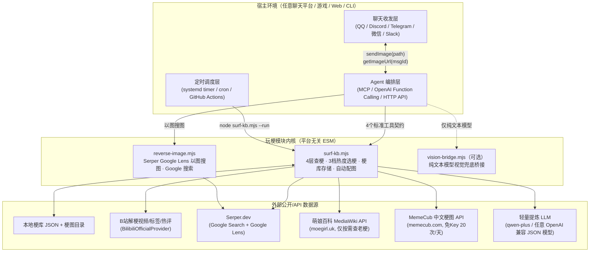

# Meme Engine Module — 可解耦的 AI「玩梗与接梗」独立模块架构与复现指南

> **文档定位**：本手册完整沉淀了一套经过真实对话高频压测的 **AI 玩梗/识梗/接梗/配图/自生长梗库模块**。  
> **设计原则**：**核心能力与宿主平台彻底解耦**——无论你要接入的是 QQ 机器人、Discord / Telegram / 微信 / Slack 机器人、直播弹幕助手、游戏 NPC，还是独立 MCP Server / HTTP 微服务，只要把本仓库与本文档交给任意新环境下的编码 Agent，即可从零复现同等效果。

---

## 1. 模块目标与最终体验标准（What "Done" Looks Like）

接入本模块后，AI 应达到以下 5 项可量化体验标准，而不仅仅是“能搜百科”：

1. **接梗不科普（Play Along, Don't Lecture）**  
   对方直接抛一句梗或名台词（如「我要验牌」「文长可担太守之责」「鸡你太美」）时，AI **不会**像百科老师一样解释电影出处，而是直接入戏接下句（如「牌没有问题！」「有何不敢！」「律师函警告！」）或直接回一张对应梗图；**只有对方明确问「这是啥梗 / 啥意思」时**，才用熟人口吻两句话简短科普。
2. **听不懂先暗查（Silent Lookup on Weird Phrases）**  
   对方发来一句字面怪异、像日语空耳/谐音/台词/黑话的短句（如「压力马斯内」「鸭蛋摸鸭蛋」「给窝擦皮鞋」），就算没问“这是什么梗”，AI 也能主动在后台暗中查清出处并自动入库，随后直接接梗，而不是按中文字面瞎回复。
3. **无字人脸/P 图梗图也能认（Reverse Image Search）**  
   面对没有配字或纯靠人脸/影视剧照/鬼畜 P 图传意的梗图（纯多模态视觉模型往往只看出“一个男的拿着显卡”），AI 可调用以图搜图反查原图人物、事件与 B 站原视频，再结合查梗链查透并自然接梗。
4. **高热度 × 高生命力自生长梗库（Self-Growing Viral KB）**  
   通过 0 常驻内存的定时巡航任务，按 **「近期全网破圈爆火（T1） > 国民级常青高活力名梗（T2） > 小众圈层梗（T3）」** 的 3 档优先级自动扩充本地梗库与接梗台词，并自动匹配下载对应中文梗图/GIF。
5. **工程代码与梗资产分离（Clean Asset Sync）**  
   核心引擎开源/可复用；长期积累的梗库 JSON、梗图与画廊相册可自动脱敏同步到独立私有仓库（如 GitHub Private Vault），换机器零丢失、零占本地磁盘。

---

## 2. 解耦架构总览（Clean Boundaries）

本模块采用 **「1 个平台无关内核 + 3 个超薄适配层」** 架构，宿主平台只需实现极简接口即可接入：



### 核心文件清单（本仓库 [`templates/`](./templates/)）

| 文件 | 角色 | 是否依赖 QQ / DSH |
| --- | --- | --- |
| [`templates/surf-kb.mjs`](./templates/surf-kb.mjs) | 玩梗模块主引擎：4 层查梗链、3 档定时学梗、每日热点、MemeCub 配图、本地 KB 读写 | **否**（仅顶部路径常量可按需改成环境变量/宿主目录） |
| [`templates/reverse-image.mjs`](./templates/reverse-image.mjs) | Serper Google Lens 以图搜图 + Google 搜索（支持 `tbs` 时间过滤） | **否**（完全独立 ESM，仅需 `serper-key.txt`） |
| [`templates/vision-bridge.mjs`](./templates/vision-bridge.mjs) | 可选视觉桥接：当主对话模型不支持图片输入时自动转调视觉模型描述画面；原生多模态模型自动直通（0 额外开销） | 仅配置读取路径可按宿主调整 |
| [`templates/sync-vault.mjs`](./templates/sync-vault.mjs) | 可选私有资产同步器：自动生成 `MEMES.md` 图文相册并推送到独立私有仓库 | 仅目录映射可按宿主调整 |

---

## 3. 核心数据结构契约（Data Contracts）

### 3.1 本地梗库条目 Schema（`meme-kb.json`）

```json
{
  "updatedAt": "2026-11-21T10:40:00.000Z",
  "memes": [
    {
      "id": "m_e68891e8a6",
      "wikiTitle": "我要验牌",
      "name": "我要验牌",
      "aliases": ["窝腰烟牌", "法国赌神", "法语口音"],
      "origin": "周星驰电影《赌侠II之上海滩赌圣》中法国赌神用魔性翻译腔说的台词。",
      "meaning": "表面要求检查扑克牌，实则讽刺虚假公平、暗箱操作，自带反讽喜剧感。",
      "usage": "质疑黑幕、抽卡歪了或结果离谱时玩梗吐槽。",
      "replies": [
        "牌没有问题！",
        "给我擦皮鞋！",
        "擦皮鞋！",
        "牌没有问题，你给我擦皮鞋！"
      ],
      "mood": ["吐槽", "嘲讽", "离谱", "玩梗"],
      "searchKeywords": ["我要验牌", "法国赌神"],
      "tier": "T2",
      "source": "moegirl-live",
      "freshDate": "常青国民梗",
      "biliUrl": "",
      "imageFile": "/path/to/memes/m_e68891e8a6.gif",
      "imageId": "12345",
      "imageTitle": "我要验牌gif表情包",
      "imageDesc": "...",
      "imageTags": ["我要验牌", "赌圣"],
      "learnedAt": "2026-11-21T08:00:00.000Z"
    }
  ]
}
```

### 3.2 工具返回契约（`presentMeme`）

查梗工具向主对话 LLM 返回时，除了 `origin` / `meaning` / `usage`，**必须附带两个关键字段**：
- `replies: string[]`：2–4 句最地道的接梗下句/名台词/捧哏回话；
- `playTip: string`：把“接梗不科普”的行为约束直接内嵌在工具返回值中（跨模型通用，实测比只写在 System Prompt 稳定得多）：
  > `若对方是直接抛梗/抛台词/说怪话（没主动问“啥意思”），请直接顺着 replies 接下句、吐槽捧哏或调 send_meme 发对应梗图，千万不要像百科老师一样解释出处！只有对方明确问“这是什么梗/啥意思”才简短解释。`

---

## 4. 四大核心子系统拆解

### 4.1 4 层实时文字查梗链（`lookupMeme`）

当 AI 收到陌生黑话/空耳/台词调用 `lookup_meme(query)` 时，按**成本由低到高、准确率交叉兜底**依次执行：

1. **Tier 1 — 本地梗库模糊评分命中（0ms / 0 成本）**  
   按精确名称（+100）、别名（+80）、子串（+50/+35）、标签/情绪（+20）、正文（+12）打分；得分 ≥ 35 直接命中。若该条目暂缺图片且 `fetchImage=true`，顺手尝试补配梗图。
2. **Tier 2 — 萌娘百科实时查词条（擅长经典 ACG / 二次元 / 老牌网络成句）**  
   通过公开 MediaWiki API（`https://moegirl.uk/api.php`，国内服务器经本地 HTTP 代理访问）搜索前 2 个候选词条，拉取 wikitext 后由提炼模型做**严格相关性校验（`relevant: boolean`）**——若只是凑巧含一两个字、毫不相干，必须返回 `false` 拒绝入库，彻底杜绝垃圾词条污染梗库。
3. **Tier 3（王牌）— B 站解梗视频 + Serper Google 并发交叉佐证**  
   - 用 `BilibiliOfficialProvider` 搜 `<query> 是什么梗`，优先排序 `梗指南 / 梗百科 / 梗科普 / 万恶之源` UP 主视频，拉取排名第 1 视频的详情、全部标签与热评前 5 条；
   - **同时并发调用 `serperGoogleSearch("<query> 是什么梗 出处", { num: 4 })`** 获取知乎 / 百度百科 / 萌娘摘要作为交叉佐证；
   - **为什么必须并发交叉佐证？** 实测发现 B 站对敏感/恶搞系词条（如「压力马斯内 / 野兽先辈 / 淫梦」）有站内过滤，单看 B 站结果会导致提炼模型望文生义（曾把「压力马斯内」胡解成“缓解现实压力”甚至张冠李戴成 MyGO 台词）。加入 Serper 并发交叉佐证后，既保留 B 站最新短视频热梗，又彻底封死望文生义幻觉。
4. **Tier 4 — 全网搜索兜底（Serper Google 优先 → 阿里云百炼原生联网回退）**  
   若前面均未命中，先用 Serper Google 摘要提炼；若无 Serper Key 则回退到阿里云百炼原生联网接口（`/api/v1/services/aigc/text-generation/generation` + `enable_search: true` + `search_strategy: "standard"`）。任何一层查到后立即写入 `meme-kb.json` 并配图，下次命中即 0ms 返回。

> **可选增强（拦截通用搜索）**：如果宿主 Agent 同时挂有通用 `web_search` 工具，可在其入口增加一个**短词梗库快路径**（严格限定 `core.length <= 12 && !/\s/.test(core)` 且含「梗/啥意思」或精准命中本地梗库），避免模型绕过 `lookup_meme` 去用通用搜索瞎找。

### 4.2 以图搜图识梗链（`reverseImageSearch`）

解决**“纯看图看不出无字人脸/影视剧照/二创 P 图是什么梗”**的终极武器：

1. **宿主适配器提取图片公网 URL**（如 QQ 消息里的 `multimedia.nt.qq.com.cn` 链接、Discord CDN 链接、Telegram 文件链接或临时对象存储 URL）。
2. **直连 Serper Google Lens API**（`POST https://google.serper.dev/lens`，`gl: "cn", hl: "zh-cn"`，支持 HTTP/2 直连，无需代理）。
3. **结构化清洗返回**：
   - 提取视觉匹配前 12 条的 `title`、`source`、`link`；
   - 自动用正则 `/BV[0-9A-Za-z]{10}/g` 抽取匹配到的 **B 站原视频 `bvid` 列表**；
4. **二段接力**：主模型拿到人物名 / 剧名 / 标题 / `bvid` 后，若一眼看懂就直接接梗；不懂就紧接着调 `lookup_meme` 或 `bilibili_video` 查透，再直接接梗（不科普）。

> **多模态模型 vs 纯文本模型适配**：
> - 若主对话模型支持原生图像输入（如 `deepseek-flash` / GPT-4o / Gemini），直接看图 + 遇不懂的梗图调 `reverse_image_search`，**零额外视觉费用**；
> - 若主对话模型为纯文本模型（如 `deepseek-v4-pro`），挂载 [`templates/vision-bridge.mjs`](./templates/vision-bridge.mjs) 自动将图片转交轻量多模态模型（如 `qwen3-omni-flash`）转成文字画面描述，并在描述末尾提示“如画面含梗可接着调 `lookup_meme` / `reverse_image_search`”。

### 4.3 自动配梗图（`fetchAndSaveMemeImage`）

- **数据源**：MemeCub 中文表情包开放接口（`GET https://memecub.com/api/v1/search?q=<kw>&limit=8`，免 Key 免费 20 次/天，国内 CDN 直连无 Cloudflare 拦截）。
- **过滤与去重**：按梗名与 `searchKeywords` 依次查询，跳过 `profane === true` 的条目，优先保留 GIF/PNG/JPG 原图下载到本地 `memes/` 目录，文件命名绑定梗 `id` 与图片 `id`，与 `meme-kb.json` 1 对 1 绑定。
- **额度保护与延迟补图**：定时任务每次最多学 5 个梗（每天 3 次 ≤ 15 次），稳稳落在免费 20 次/天额度内；若当天人工测试刷爆额度，条目先存文字与 `replies`，次日触发 `send_meme` 或再次 `lookup_meme` 时会自动补全图片。

### 4.4 「破圈热度 × 当前生命力」3 档定时学梗引擎（`runDailySurf`）

**核心教训**：
- 不能按百科分类 `timestamp` 随机抓（百科的 timestamp 是编辑时间，会把 10 年前改了个错别字的死梗排到第一）；
- 也不能无脑只抓“最近 7 天最新视频”（容易抓进大量小圈子电竞/特定战队/垂直小众梗）。

**正确解法——混合候选池 + 3 档破圈评委（`rankMainstreamCandidates`）**：

1. **候选池 A（近期破圈新梗）**：Serper 按 `tbs: "qdr:m"`（近 1 月）和 `tbs: "qdr:y"`（近 1 年）抓 `site:bilibili.com/video "是什么梗" ("梗指南" OR "白给梗科普")`；
2. **候选池 B（B 站百万播放爆款）**：B 站官方搜索 `梗指南` 按 `order: "click"`（播放量最高）排序，严格过滤 **播放量 ≥ 50 万**；
3. **候选池 C（常青国民高活力梗池）**：内置 45 个至今高频活跃的国民名梗（鸡你太美、华强买瓜、疯狂星期四、哈基米、牢大、头顶尖尖的、世界是个巨大的草台班子、红温了、九转大肠等），过滤掉已学会的条目；
4. **LLM 评委严格 3 档排序**：
   - **T1（最高优）**：近几个月～1 年内**全网真正破圈爆火**的热梗（同等国民热度下压过老梗）；
   - **T2（次高优）**：诞生较久但**至今生命力极强**的国民常青梗（压过所有小众新梗）；
   - **T3（垫底）**：小众圈层梗（单战队/单主播/垂类小游戏梗），仅当 T1/T2 均收完时才补位。

---

## 5. 灵魂所在：让 AI 真正“接梗”而不是“科普”（Prompt 契约）

仅有工具不够——如果没有正确引导，几乎所有大模型在查完梗之后都会条件反射地当起“百科老师”。**必须在 3 个位置同时对齐**（可直接复制到任意宿主的 System Prompt 与工具定义中）：

### 5.1 System Prompt 片段（平台无关，直接复用）

```text
【玩梗与接梗铁律】
- 听不懂先暗查：对方发来一句字面怪异、无厘头、像空耳/谐音/台词/缩写/黑话的短句（例如「压力马斯内」「我要验牌」「文长可担太守之责」等），就算对方没问“这是啥梗”，只要你不确定它是不是梗，先暗中调 lookup_meme 查清并自动入库（图片认不出就调 reverse_image_search），绝不要按字面硬答或装懂敷衍。
- 接梗不科普：对方直接抛梗、抛名台词或发表情梗图时，查懂以后【直接入戏接梗】——顺着 replies 接下一句经典台词、顺着梗的语境捧哏/吐槽，或直接用 send_meme 回一张对应梗图（也可以先接一句台词再补一张梗图）。例如对方说「我要验牌」，你就直接回「牌没有问题」或接赌神台词，千万不要像百科老师一样解释出处！
- 只有对方明确问「这是什么梗/啥意思/求科普」时，才用熟人口吻简短两句讲清笑点，别写小作文。
```

### 5.2 工具注册契约（4 个标准工具，适配 MCP / OpenAI Tools / HTTP）

| 工具名（按宿主加前缀） | 参数 | 核心职责与描述要点 |
| --- | --- | --- |
| `lookup_meme` | `{ query?: string, fetchImage?: boolean }` | 4 层查梗并自动入库配图，返回出处、笑点、`replies` 与 `playTip`。描述中明确写“遇字面怪异/疑似空耳短句先暗查，查完直接接梗别科普”。 |
| `send_meme` | `{ ref: string, replyToMessageId?: string }` | 按梗 `id` 或梗名解析出本地图片路径并通过宿主通道单独发图（不附文字）；若本地无图自动尝试实时补图。 |
| `reverse_image_search` | `{ messageId?: string, imageUrl?: string, imageIndex?: number }` | 调用 Serper Google Lens 反查无字/人脸/剧照/表情包梗图，返回视觉匹配标题与 B 站 `bvid`。 |
| `get_daily_feed` | `{}` | 读取当日定时巡航洗炼好的热点与最近新学的热梗（含示例 `replies`）。 |

### 5.3 合理预期说明
像「oh yes sir, thank you sir」这类本身语法完全正常的日常句子，模型在无上下文提示时有时会按正常英文回复——**这是合理的，切忌把 Prompt 写得过于神经质导致 AI 对每句正常人话都去查梗**。只要模型在用户稍微暗示或遇到明显怪异/空耳/经典抛梗句时能秒查秒接，日常体感就是最自然的。

---

## 6. 新环境零背景接入步骤（Integration Checklist）

一个全新的 Agent 在新机器/新框架上复现本模块，按以下 6 步执行即可：

### Step 1：准备运行环境与密钥（严禁入库！）
- 运行时：Node.js ≥ 20（原生 `fetch` + ESM）、`curl`。
- 两个 API Key 文件（权限 `chmod 600`，加入 `.gitignore`）：
  1. **轻量提炼 LLM Key**（如阿里云百炼 `DASHSCOPE_API_KEY`，或将 `callDashScopeJson` 替换为任意支持 JSON 输出的 OpenAI 兼容端点）；
  2. **Serper.dev Key**（注册即送 2,500 次免费额度，同时驱动 Google Lens 以图搜图 + Google 搜索）。
- 可选依赖：
  - 若需 B 站解梗引擎：安装或引入 `BilibiliOfficialProvider`（或兼容的 B 站搜索/视频/标签/热评接口）；
  - 若在国内机器启用萌娘百科按需兜底：准备本地 HTTP 代理（如 `127.0.0.1:7890`）；Serper、MemeCub、B 站均直连无需代理。

### Step 2：落盘核心模块并参数化路径
1. 复制 [`templates/surf-kb.mjs`](./templates/surf-kb.mjs) 与 [`templates/reverse-image.mjs`](./templates/reverse-image.mjs) 到宿主项目目录（如 `<APP_ROOT>/src/`）。
2. 将顶部 5 个路径常量调整为宿主目录（或改为读取环境变量 `MEME_KB_ROOT` / `SERPER_KEY_FILE` / `LLM_KEY_FILE`）：
   - `DAILY_FEED_PATH`
   - `MEME_KB_PATH`
   - `MEME_DIR`
   - `DASHSCOPE_KEY_PATH`（或自选 LLM Key）
   - `DEFAULT_KEY_PATH`（`reverse-image.mjs` 中的 Serper Key 路径）
3. 语法校验：`node --check surf-kb.mjs reverse-image.mjs`。

### Step 3：编写宿主薄适配层（仅需 ~40 行胶水代码）
将 4 个函数暴露为你所在框架的工具（MCP `server.tool` / OpenAI Function Calling / HTTP Route）：
- `lookup_meme` → 直接调用 `lookupMeme(query, { allowLive: true, fetchImage })`；
- `send_meme` → 调用 `resolveMemeImage(ref)` 拿到 `meme.imageFile`，再调宿主的发图 API（如 OneBot `base64://`、Discord `AttachmentBuilder`、Telegram `sendPhoto/sendAnimation`、微信上传媒体等）；
- `reverse_image_search` → 从宿主消息记录中解析出目标图片 URL（若平台图片是私有地址，先转存临时公网签名 URL），调用 `reverseImageSearch(imageUrl)`；
- `get_daily_feed` → 直接调用 `readDailyFeed()`；并可在每日首次唤醒或主动开话题时轻度注入 `formatDailyFeedHint()`。

### Step 4：注入三处行为提示词
按第 5 节，将 **【玩梗与接梗铁律】** 写入宿主 System Prompt，更新 4 个工具的描述，并确保 `presentMeme()` 保留 `replies` 与 `playTip`。

### Step 5：配置 0 常驻内存定时巡航
不要在主进程常驻定时器爬网，直接用系统级 `cron` 或 `systemd timer`（每天 2–3 次，每次 `--max-memes 5`，跑完即释放全部内存）：
```bash
# crontab 示例（每天 09:30 / 14:30 / 20:30 执行）
30 9,14,20 * * * /usr/local/bin/node /path/to/src/surf-kb.mjs --run --max-memes 5 >> /var/log/meme-surf.log 2>&1
```

### Step 6：（可选）接入私有资产库同步
参考 [`templates/sync-vault.mjs`](./templates/sync-vault.mjs)，将 `meme-kb.json` 与 `memes/` 自动生成 Markdown 图文相册（`MEMES.md`）并增量推送到独立 Private GitHub Repo（仅授予单仓库写权限 Deploy Key，绝不把 API Key 或 Session Token 推入仓库）。

---

## 7. 实战踩坑与避雷速查（10 条血泪经验）

| 序号 | 真实踩过的坑 | 根因 | 最终稳健方案 |
| --- | --- | --- | --- |
| 1 | 萌娘百科 `zh.moegirl.org.cn/api.php` 报错 `action-notallowed` | 主站禁止匿名 API 请求 | 改用镜像 `moegirl.uk/api.php`（经代理 JSON 返回 200） |
| 2 | 抓萌娘百科配图 403 / 失败 | `moegirl.uk/images/` 有 Cloudflare 人机验证（**严禁绕过**） | 彻底放弃爬百科图片，改用开放中文表情包接口 `memecub.com/api/v1/search` |
| 3 | 萌娘模糊搜索把风马牛不相及的词条存入梗库 | 搜索只按字面召回，未做语义校验 | 在 `distillMemeFromWikitext` 增加 `relevant: boolean` 严格校验 |
| 4 | B 站连续多次搜索触发 `bilibili risk control rejected` | 匿名搜索高频并发触发风控 | 定时发现改用 **Serper + `site:bilibili.com/video`** 为主；B 站直查单次温和调用 + 请求间留 `1.8s` 间隔 |
| 5 | 「压力马斯内」被 B 站层胡解成“缓解现实压力”甚至张冠李戴成 MyGO 台词 | B 站站内屏蔽淫梦/野兽先辈词条导致线索稀疏 + 国内模型望文生义 | B 站层**并发叠加 Serper Google 摘要做交叉佐证**，Prompt 明确禁止按字面望文生义或张冠李戴 |
| 6 | 阿里云百炼 `/compatible-mode` 开 `enable_search` 返回 0 来源并瞎编 | OpenAI 兼容端点对联网搜索参数支持不稳定 | 兜底层优先 Serper Google Search；百炼回退改用原生接口 `/api/v1/services/aigc/text-generation/generation` + `search_strategy: "standard"` |
| 7 | 定时巡航抓出一堆 10 年前老梗（如「这么强」） | 萌娘百科分类 `cmsort=timestamp` 是**最近编辑时间**而非诞生时间 | 定时巡航移除萌娘随机分类抓取，改用 3 档「破圈热度 × 生命力」排序 |
| 8 | 改成 `qdr:w` 近 1 周后又抓出一堆小众电竞梗（如 `Chovy根号四`） | 只看时间不看破圈播放量，小圈子视频占多数 | 引入 B 站 `order=click`（≥ 50 万播放）+ 常青高活力池 + LLM 3 档评委（T1 近期破圈 > T2 国民常青 > T3 小众） |
| 9 | 多模态视觉模型看不懂无字人脸/P 图梗图，国内 `image_search` 接口也对人脸返回空 | 视觉模型擅长描述画面但不擅长全网反查同款出处；部分国内搜图 API 屏蔽人脸 | 接入 **Serper Google Lens (`google.serper.dev/lens`)**，对人脸/剧照/P 图梗图可稳定返回数十条原图与 B 站原视频线索 |
| 10 | 通用 `web_search` 的梗库快路径误拦截含“梗”字的长句查询 | 正则过宽，未限制查询词长度 | 收紧快路径守卫条件：`core.length <= 12 && !/\s/.test(core)` |

---

## 8. 端到端验收清单（Definition of Done）

新环境部署完成后，按下面 2 组测试验收，**全部通过即视为达到生产标准**：

### A. 模块级自动化冒烟测试（CLI）
```bash
# 1. 语法与依赖检查
node --check src/surf-kb.mjs src/reverse-image.mjs

# 2. 定时巡航 3 档选梗实测（应优先产出 T1 近期破圈或 T2 国民常青梗，而非冷门小众梗，且均含 replies + playTip）
node src/surf-kb.mjs --run --max-memes 3

# 3. 实时空耳/热梗查梗实测（验证交叉佐证无望文生义 + 自动入库 + 返回 replies 与 playTip）
node -e 'import("./src/surf-kb.mjs").then(async m => console.log(JSON.stringify(await m.lookupMeme("我要验牌"), null, 2)))'

# 4. 以图搜图实测（传入一张无字表情包/剧照公网 URL，应返回 visual matches）
node -e 'import("./src/reverse-image.mjs").then(async m => console.log(JSON.stringify(await m.reverseImageSearch("<PUBLIC_MEME_IMAGE_URL>"), null, 2)))'
```

### B. 对话级体感验收（5 条实聊测试）
1. **直接抛梗测试**：发 `我要验牌` → AI 应直接回 `牌没有问题` / `给我擦皮鞋` 等接梗台词（或发对应梗图），**禁止科普电影出处**；
2. **陌生空耳暗查测试**：发一个库里尚未收录的怪异空耳/黑话（不问“这是什么梗”）→ AI 后台自动调用 `lookup_meme` 入库，随后直接接梗；
3. **显式求科普测试**：问 `XX 是什么梗？` → AI 用 1–2 句群友口语简短讲清笑点，不写长篇百科小作文；
4. **无字梗图识别测试**：发一张没有配字的人脸/P 图/剧照梗图 → AI 自动调 `reverse_image_search` 认出人物和原梗，顺着接话；
5. **发梗图测试**：让 AI 发一张对应梗图或自然斗图 → 能正确经宿主发出清晰图片/GIF 且不附带多余文字。
