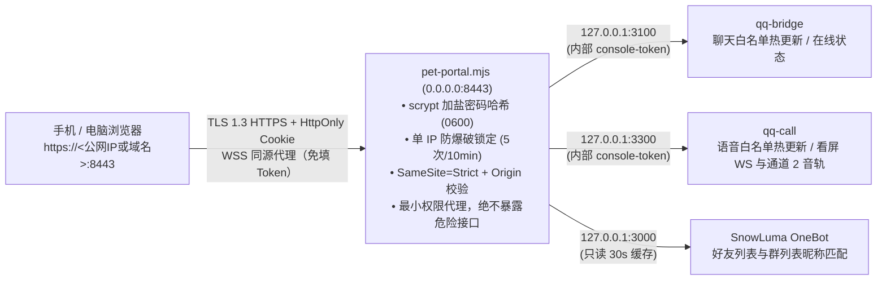

# Pet Portal — 统一远程 HTTPS 管理台与物理三通道看屏网关

> **文档定位**：消除每次看屏/改白名单都需要本机开 SSH 端口转发的繁琐流程，提供一个**手机与电脑浏览器均可直接打开的统一远程 HTTPS 管理台**（`https://<公网IP或域名>:8443`），整合 **QQ 私聊/群聊/语音白名单热管理（支持搜好友昵称一键放行）+ 物理三通道 1080p 看屏推音 + 服务状态与密码安全**；同时附带**仅管理员 QQ 生效的私聊 `/白名单` 快捷口令**。  
> **模板文件**：[`templates/pet-portal.mjs`](./templates/pet-portal.mjs)（零外部框架独立网关，~35 MB 内存）、[`templates/qq-call-adapter.mjs`](./templates/qq-call-adapter.mjs)（`GET/POST /api/call/whitelist` 热更新接口）。

---

## 1. 安全边界与架构



- **绝不把 `qq-bridge (3100)`、`qq-call (3300)` 或 `dsh-web (3080)` 直接暴露到 `0.0.0.0`**；内部 `console-token` 永远留在服务端，绝不下发给前端浏览器。
- **为什么必须走 HTTPS**：
  1. 浏览器安全策略要求 `getDisplayMedia()`（共享屏幕 + 音频）必须在安全上下文（`https://` 或 `localhost`）下运行；明文 `http://<IP>:端口` 会直接屏蔽录屏接口。
  2. 防止公网 Wi-Fi / 4G / 5G 环境下明文传输管理密码、会话 Cookie 与屏幕画面。
- **无域名阶段 vs 后续绑域名无缝切换**：
  - **无域名阶段（开箱即用）**：首次启动自动通过 `openssl` 生成带 `SAN=IP:<公网IP>` 的 ECDSA P-256 自签证书（`state/portal-tls/`）。Chrome/Edge 首次打开点击「高级 → 继续前往」即可全功能使用 1080p 物理三通道共享屏幕；也可在「状态与安全」页下载 `.crt` 证书在 Mac 钥匙串中信任一次变永久绿锁。
  - **后续绑定正式域名**：在 `config.json` 的 `portal.certPath` / `portal.keyPath` 指向 Let's Encrypt 正式证书（或前置 Caddy / Cloudflare Tunnel 反向代理到本服务），无需改任何前端或业务代码。

---

## 2. 核心功能

### 2.1 白名单可视化热管理（手机端默认首页）
- **搜昵称 / 备注一键加减**：自动拉取 SnowLuma QQ 好友列表与群列表（30 秒内存缓存），输入好友昵称、备注或 QQ 号，一键点亮/取消「💬 聊天」或「📞 通话」按钮，**秒级热生效无需重启**。
- **支持手动按 QQ 号放行**：即使对方尚未出现在缓存列表，也可直接输入 QQ 号点「+ 聊天白名单」「+ 语音白名单」或「+ 聊天+语音全加」。
- **语音通话总开关与群通话防护开关**：随时一键暂停/恢复自动接听来电。

### 2.2 一体化看屏 & 物理三通道（免 SSH、免贴 Token、零滞后）
- 登录后自动建立同源 `wss://<host>/ws/screen` 连接（通过 `HttpOnly` 登录 Cookie 鉴权，不再需要复制 `console-token`）。
- **零滞后后台/全屏推屏引擎**：内置 **Web Worker 后台防限频定时器 + `ImageCapture.grabFrame()` 直接抓流**（切后台或全屏播放器永不冻结）+ **`ws.bufferedAmount > 32KB` 严格背压跳帧** + 默认 `720p/960px q=0.62`（~45KB/帧）+ 开口瞬间服务端下发 `snap_now` 即时抓帧，端到端画面同步压至 `<1s`。
- 电脑 Chrome/Edge 直接点「选择屏幕 / 标签页」+ 勾选「分享音频」即可与普通 QQ 语音组成**物理三通道**；手机打开同一 Tab 时自动提示并支持遥控陪看模式、静音屏幕音轨、文字提问与查看实时吐槽流。

### 2.3 主人 QQ 私聊快捷口令（连网页都不用开）
仅对 `config.json` 中的 `ownerQQ` 生效（其他人发一律拦截），出门在外直接在 QQ 给机器人发私聊即可：

| 私聊口令 | 效果（即时热生效） |
| --- | --- |
| `/全白名单 加 <QQ号>` | 同时加入私聊聊天白名单 + 语音通话白名单 |
| `/全白名单 删 <QQ号>` | 同时移出私聊聊天白名单 + 语音通话白名单 |
| `/白名单 加 <QQ号>` / `/白名单 删 <QQ号>` | 仅增删私聊聊天白名单 |
| `/通话白名单 加 <QQ号>` / `/通话白名单 删 <QQ号>` | 仅增删语音通话白名单 |
| `/群白名单 加 <群号>` / `/群白名单 删 <群号>` | 增删群聊白名单 |
| `/白名单` | 查看当前私聊 / 群聊 / 语音全部白名单 |

---

## 3. 部署与初始化

1. 在宿主 `/opt/qq-bridge/config.json` 中补充非敏感的端口配置：
   ```json
   "portal": {
     "port": 8443,
     "host": "0.0.0.0",
     "publicHost": "<YOUR_SERVER_PUBLIC_IP_OR_DOMAIN>"
   }
   ```
2. 创建 systemd 服务 `/etc/systemd/system/pet-portal.service`（内存上限 96 MB）：
   ```ini
   [Unit]
   Description=pet-portal (HTTPS Remote Admin & 3-Channel Screen Gateway)
   After=network-online.target qq-bridge.service qq-call.service
   Wants=qq-bridge.service qq-call.service

   [Service]
   Type=simple
   User=root
   WorkingDirectory=/opt/qq-bridge
   Environment=NODE_OPTIONS=--max-old-space-size=96
   ExecStart=/usr/local/bin/node /opt/qq-bridge/src/pet-portal.mjs
   Restart=always
   RestartSec=3

   [Install]
   WantedBy=multi-user.target
   ```
3. 启动并在云厂商安全组放行 `TCP 8443`：
   ```bash
   systemctl daemon-reload && systemctl enable --now pet-portal
   cat /opt/qq-bridge/state/portal-initial-password.txt   # 查看首次随机生成的登录密码
   # 可随时在网页「状态与安全」改密码，或命令行重设：
   node /opt/qq-bridge/src/pet-portal.mjs --set-password "<NEW_STRONG_PASSWORD>"
   ```
