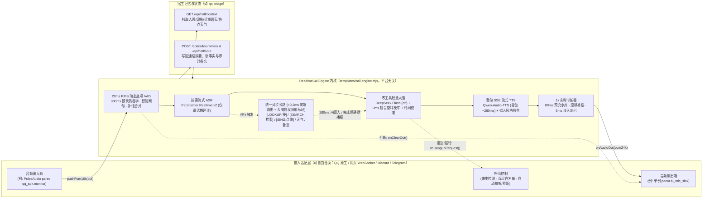

# Realtime Call Module — 可解耦的 AI 原生全双工实时语音通话模块架构与复现指南

> **文档定位**：本手册完整沉淀了一套已在真实生产环境通过多次 5–7 分钟连续实聊压测的 **AI 全双工实时语音通话模块**。  
> **核心指标**：使用 AI 自己的原声（非端到端固定音色）、**端到端平均响应 ~1.2–1.6 秒**、**真·全双工瞬时打断（< 100ms 停播、零双声轨重叠）**、**零回声**、**与文字聊天双向记忆互通**、**常驻仅 ~67 MB 内存**。  
> **解耦设计**：内核 [`templates/call-engine.mjs`](./templates/call-engine.mjs) 与宿主平台彻底解耦；本文同时给出 **QQ 原生语音通话适配层**（[`templates/qq-call-adapter.mjs`](./templates/qq-call-adapter.mjs)）的完整落地 SOP，以及接入 WebRTC / 网页 / Discord / Telegram 等其他宿主的极简接口契约。

---

## 1. 模块定位与最终体验标准（What "Done" Looks Like）

接入本模块后，AI 的语音通话体验应达到以下 6 项可验证标准：

1. **原声一致且松弛拟人**：复用 AI 原本的专属 TTS 音色（如 `qwen-audio-3.1-tts-flash` + 自定义 `instruction` 风格控制），带自然生活气、轻声气口和停顿，**不是播音腔**，并且同步应用于普通语音条发送。
2. **听得清、不抢话、不卡顿**：动态自适应底噪 VAD + 智能耐心断句（完结句 `640ms` 利落接话，思考停顿/未完连接词 `1240ms` 耐心等待 + 思考期补话合并），日常端到端响应约 **1.2–1.6 秒**。
3. **真·全双工可打断，零声音重叠**：内置 **1x 实时播放节拍器 + 80ms 预充水库**，全程单播放流；对方打断时 0ms 清空播放队列（~80ms 内彻底停播，绝无双声轨重叠），并按实际播放字节比精确计算“说到哪儿被打断”，注入下一轮上下文。
4. **双声道物理零回声（原生客户端方案）**：在虚拟声卡层面将“对方声音”与“AI 说话”彻底拆分为两条隔离管线，AI 永远听不到自己的声音，服务端可干净地边说边听。
5. **与文字聊天双向记忆打通 + 实时玩梗**：接通瞬间拉取长期印象、最近聊天与当前精确北京时间（防止旧事当成“今天”）；通话中 0ms 匹配本地梗库直出接梗台词；挂断后自动提炼摘要与新事实写回文字聊天记忆。
6. **独立白名单 & 费用护栏**：仅接白名单好友单聊来电（双层校验，拒接陌生人与群通话）；仅在说话期间推流 ASR 省 50%+ 识别费；沉默 120s 主动问“还在吗”/150s 自动挂断防忘挂；60 分钟软提醒不挂断；每日总时长兜底限额。

---

## 2. 解耦架构总览（1 个平台无关内核 + 任意接入适配器）



### 核心文件清单（本仓库 [`templates/`](./templates/)）

| 文件 | 职责 | 平台耦合度 |
| --- | --- | --- |
| [`templates/call-engine.mjs`](./templates/call-engine.mjs) | 平台无关全双工通话内核（VAD / 按需 ASR / 轻量大脑 / 0ms 拼音空耳梗库 / 自发隐形工具 `[LOOKUP]`·`[SEARCH]`·`[SING]` / SSE TTS / 1x 节拍器 / 打断截断 / 摘要写回） | **零耦合**（可接入任意宿主） |
| [`templates/meme-matcher.mjs`](./templates/meme-matcher.mjs) | 零依赖中文拼音 + 近音空耳滑窗模糊梗库匹配器（与普通文字聊天 `surf-kb.mjs` 共用） | **零耦合**（纯 Node ICU） |
| [`templates/qq-call-adapter.mjs`](./templates/qq-call-adapter.mjs) | QQ 原生语音通话守护进程（PulseAudio 虚拟声卡管理、X11 来电检测、双层白名单校验、音频桥接、异步点歌与挂断转 QQ 语音兜底、`127.0.0.1:3300/health`） | 仅适配 LinuxQQ + Docker 容器 |

### 宿主对接极简契约（接入任何新平台只需实现 5+1 个回调）

```js
const engine = new RealtimeCallEngine({
  callerId: '<USER_ID>',
  callerName: '<USER_NAME>',
  defaultCity: '<OPTIONAL_CITY>',
  onAudioOut: (pcm24kBuf) => { /* 写入你的播放器 / WebSocket / WebRTC / 虚拟麦 */ },
  onClearOut: () => { /* 写入 40~80ms 静音或清空客户端播放缓冲 */ },
  onHangupRequest: (reason) => { /* 执行挂断 */ },
  getContext: async (callerId) => ({ impression, recentMessages, dailyFeedText }),
  onSummary: async (report) => { /* 把 report.summary 与 report.facts 写回宿主记忆 */ },
  onSidecarTask: async (task) => { /* 可选异步旁路：remember / weather / meme / web_search，返回简短文本 */ }
});

await engine.start();
// 持续喂入 16kHz / 16bit / 单声道 PCM：
audioInputStream.on('data', (pcm16k) => engine.pushPcm16k(pcm16k));
// 挂断时清理并生成摘要：
await engine.stop('remote_hangup');
```

---

## 3. 关键技术方案深度拆解

### 3.1 为什么不换 OneBot 框架而走「虚拟声卡 + 原生 LinuxQQ」？
主流 QQ 协议端（SnowLuma / NapCat / LLOneBot / Lagrange）及 QQ 官方机器人**均未开放好友实时语音通话 API**。但容器内运行的是完整的 LinuxQQ（Electron + `libAVSDKPlugin.so` / TRAE 引擎），只要满足两个条件即可原生态接通真·QQ 语音电话：
1. **补齐缺失依赖库**：容器内安装 `pulseaudio`、`pulseaudio-utils` 与 **`libpulse-mainloop-glib0`**（LinuxQQ 的 `libAVSDKPlugin.so` 强依赖 `libpulse-mainloop-glib.so.0`，缺它会导致插件加载失败且无弹窗）；
2. **双虚拟声卡隔离配置（`/etc/pulse/qq-call.pa`）**：
   ```text
   load-module module-native-protocol-unix auth-anonymous=1
   load-module module-null-sink sink_name=qq_spk rate=48000 channels=1 sink_properties=device.description=QQ_Speaker
   load-module module-null-sink sink_name=ai_mic_sink rate=48000 channels=1 sink_properties=device.description=AI_Mic_Feed
   load-module module-remap-source master=ai_mic_sink.monitor source_name=ai_mic rate=48000 channels=1 source_properties=device.description=AI_Microphone
   set-default-sink qq_spk
   set-default-source ai_mic
   ```
   > **关键细节**：必须用 `module-remap-source` 把 `ai_mic_sink.monitor` 重映射为非 monitor 类型的普通源 `ai_mic`，否则 Chromium/TRAE 会忽略 monitor 设备，无法识别为麦克风！同时写 `/etc/asound.conf` 把 ALSA `default` 指向 `pulse`，并将 PulseAudio 写入 `/etc/supervisor/conf.d/pulseaudio.conf`（`priority=5`）持久化。

### 3.2 低延迟级联流水线（原声 + ~1.4s 响应的秘密）
不用端到端语音模型（会丢失专属音色），而是把级联 4 步每一段榨干到极限：

| 环节 | 选型与核心优化 | 实测耗时 |
| --- | --- | --- |
| **本地 VAD + 断句** | 20ms RMS 动态底噪跟踪 + 300ms 预录防吞字；完结句 `640ms` 断句，仅对真正未完连接词（`然后/但是/那个/嗯`）或 ≤ 3 字延长至 `1240ms`；思考期补话自动取消旧生成并合并两半句 | 0ms（本地） |
| **流式 ASR** | DashScope `paraformer-realtime-v2` 双工 WebSocket，**仅在用户开口期间建连推流**（静音期 0 费用），说完即发 `finish-task` | **20–250ms** |
| **零工具轻量大脑** | 为通话新建独立 **零工具 DSH 预设 `qq-call`**（`ctx.tools.restrict({ allow: [] })`），复用现有 `deepseek-flash`（`reasoningEffort: "off"`，零新增 API Key），开场注入当前精确北京时间与记忆快照，每轮 0ms 匹配本地梗库 | **500–1100ms** |
| **整句 SSE 流式 TTS** | `qwen-audio-3.1-tts-flash`（`X-DashScope-SSE: enable`, `format: "pcm"`, `sample_rate: 24000`），按完整句子送合成（不在每个逗号处切碎，保证整句自然语调），自动剥离括号舞台动作与偶发裸 `<toolcall>` 标签，配合拟人化 `instruction` 控制稍慢语速、生活气和轻声气口 | **首包 260–310ms** |
| **1x 节拍播放与打断** | `performance.now()` 漂移补偿节拍器（10ms 调度）+ **`180ms` 水库预充与 `_ttsStreaming` 门控** + 偶数字节对齐 + 首尾 5ms 淡入淡出；宿主机侧对 PulseAudio / AudioService `renice -n -10`；全程单例 `pacat --latency-msec=100`，打断 0ms 清空队列，道别挂断倒计时遇继续说话自动取消且防片名/热梗误触 | **打断 < 100ms** |

### 3.3 双层好友白名单机制（严防陌生人与群通话）
1. **Layer-1 接听前校验**：检测 `360x640` 来电窗口 → 点击无害的 `异常提示/我知道了` 按钮露出来电人卡片 → 截取 `360x640` 画面经轻量视觉模型校验 `isIncoming === true`、`isGroupCall === false` 且 `callerName` 匹配白名单好友（由 OneBot `get_friend_list` 动态解析昵称与备注，过滤 `私聊/管理员` 等占位词）→ 命中后随机延迟 `1.5–2.8s`（模拟真人接听节奏）点击接听，未命中直接拒接；
2. **Layer-2 接听后防伪复核**：接听 3 秒后复核底层信令日志 `from=<UIN> msgType=529/11`，若真实数字 QQ 号不在白名单内则瞬间挂断。

### 3.4 统一异步旁路工具（零降速获得查天气 / 查梗 / 联网搜索 / 记备忘 / 实时点歌 / 语音指挥游戏）
为了保住 ~1.4s 极速通话响应，主对话大脑继续保持零工具（`qq-call`），同时在 `call-engine.mjs` 内嵌了 **< 0.2ms 前端快路由（`detectSidecarTask`）** 与 **大脑自发隐形标记解析（`parseBrainSidecarTag`：`[LOOKUP:关键词]` / `[SEARCH:关键词]` / `[SING:模式|歌名|歌手]` / `[GAME:游戏指令]`，送入 TTS 前自动剥离绝不念出）**：
- **支持的 6 类通话旁路工具**（通过宿主回调 `onSidecarTask` 注入，保持引擎平台无关）：
  1. **记备忘（`remember`）**：识别「帮我记一下 / 别忘了提醒我…」，毫秒级调用 `POST /api/call/note` 写入 `social-v2.json` 活跃话题与 `life-journal.jsonl`；
  2. **查天气（`weather`）**：提取通话提到的城市或回退默认城市，调用免 Key 天气模块（`wttr.in` + `Open-Meteo` 中文回退，3 小时缓存）；
  3. **实时查梗（`meme`）**：本地 0ms 拼音空耳梗库未命中且用户追问「啥梗/什么意思/你知道 XXX 吗」或大脑自发 `[LOOKUP:关键词]` 时，带近 3 轮对话上下文异步走 `lookupMeme` 做同音纠偏；
  4. **联网搜索（`web_search`）**：显式查询或大脑自发 `[SEARCH:关键词]` 时，后台走 Serper 搜索摘要；
  5. **实时点歌翻唱与秒唱（`sing`）**：大脑自发 `[SING:mode|歌名|歌手]` 触发独立序号 `_singSeq`（绝不与中途查梗/查天气互掐），并与 **通话内唱歌状态机 + 三道防幻觉护栏** 联动：
     - **开场曲库注入**：接通时自动扫描 `song-cache` 注入上下文——熟歌 **0 秒直接开唱**，不在曲库的新歌第一时间如实告知需等 2–3 分钟先聊别的；
     - **逐轮状态注入 + TTS 前硬护栏**：后台渲染期间（`preparing`）每轮注入 `[唱歌实时状态]`（含已准备秒数），并在送入 TTS 前兜底拦截未说等待提示或误吐「唱完啦/咋样」的幻觉，同时对同曲重复 `[SING]` 自动去重并隔离过期旧回调；
     - **准备期静默守护 + 挂断单发兜底**：新歌准备期暂停沉默自动挂断（静默满 45s 主动温和安抚一次）；成品就绪后自动等对话安静空档直接注入 1x 节拍器唱进听筒（全程支持随时开口 **0ms 打断**）；若唱好前已挂断，仅对最新有效点歌（`seq === _singSeq`）转成一条 QQ 语音补发。
  6. **联机游戏双向指挥与高光播报（`game`）**：当 `game-hub` 有活跃游戏（如 Minecraft 或小丑牌等 Neuro-API 游戏）时，每轮自动注入实时血量/饥饿/任务态势；大脑输出 `[GAME:动作指令]` 即可异步操控游戏角色；同时开放 `POST /api/call/game-event`，遇苦力怕/掉血/高光瞬间在对方安静空档主动原声惊呼吐槽（详见 [`game-companion-module.md`](./game-companion-module.md)）。
- **180ms 快慢双通道，绝不卡主对话**：
  - ≤ 180ms 完成的（如本地记备忘、已缓存天气）直接注入**当前回合**，一步到位回答；
  - 超过 180ms 的（如联网检索、实时天气）先让主线程零延迟自然过渡一句（「等等啊我瞄一眼手机」），1–2 秒结果返回后若用户未抢话，自动静默触发一轮口语播报；若用户已在说新话题，则不打断、并入下一轮自然带出。

### 3.5 同步美化普通 QQ 语音条（`qq-tts`）
将同样的拟人化风格指令写入 `/opt/qq-tts/config.json` 的 `dashscope.instruction`，并在 `cleanForApi` 中自动剔除 `（笑）` 等括号舞台动作描写、在 `qq_send_voice_text` 描述中引导 1–2 句松弛口语、拒绝句首堆叠语气词，即可让文字聊天里发的语音条与实时通话保持一致的真人质感。

---

## 4. 零背景新环境复现步骤（Step-by-Step SOP）

### Step 1：容器虚拟声卡与 AVSDK 依赖（仅 QQ 原生方案需要）
1. 在 QQ 容器内安装 `pulseaudio`、`pulseaudio-utils`、`libpulse-mainloop-glib0`；
2. 写入 `/etc/asound.conf`（ALSA → `pulse`）、`/etc/pulse/qq-call.pa`（`qq_spk` + `ai_mic_sink` + `ai_mic`）以及 `/etc/supervisor/conf.d/pulseaudio.conf`；
3. 重启 QQ 进程并确认 `pactl list short clients` 出现 `qq` 客户端；
4. 拨打 1 次测试电话，确认日志出现 `defaultInputDeviceName=AI_Microphone, defaultOutputDeviceName=QQ_Speaker`。

### Step 2：部署零工具轻量通话预设 `qq-call`（DSH 宿主）
1. 创建 `plugins/qq-agent-presets/qq-call-no-tools.mjs`（调用 `ctx.tools.restrict({ allow: [] })` 与 `ctx.tools.guard(...)`）；
2. 创建 `dsh/agent-presets/qq-call/{preset.yml,agent.cordis.yml}`，设定口语通话铁律（1–2 句短话、严禁 Markdown/括号动作、严禁句首堆砌语气词、核对当前日期、告别输出 `[HANGUP]`）；
3. 注册进 `build-agent-preset-patches.mjs` 与 `plugins/qq-agent-presets/package.json`，生成并校验 `qq-call.patch.yml`，重启 `dsh-web`。

### Step 3：接入记忆与旁路端点（宿主 Bridge）
在宿主服务上暴露 3 个仅监听 `127.0.0.1` 的鉴权接口：
- `GET /api/call/context?qq=<ID>`：返回 `{ impression, recentMessages, dailyFeedText }`；
- `POST /api/call/summary`：接收 `{ callerId, callerName, durationSec, summary, facts }`，写入长期印象与最近会话记录（含 `time` + `at` 双时间戳）并落盘；
- `POST /api/call/note`：接收通话异步旁路写入的 `{ callerId, callerName, text }` 备忘提醒，实时更新活跃话题并落盘。

### Step 4：落盘模块并配置白名单与守护服务
1. 复制 [`templates/call-engine.mjs`](./templates/call-engine.mjs) 与 [`templates/qq-call-adapter.mjs`](./templates/qq-call-adapter.mjs) 到宿主 `src/` 目录（确保 `ws` 依赖可解析）；
2. 在宿主 `config.json` 中添加 `call` 配置块：
   ```json
   "call": {
     "enabled": true,
     "whitelist": ["<OWNER_QQ>"],
     "allowGroupCall": false,
     "softReminderMin": 60,
     "dailyLimitMin": 180,
     "silenceAskSec": 120,
     "silenceHangupSec": 150,
     "port": 3300
   }
   ```
3. 注册 `qq-call.service`（建议 `NODE_OPTIONS=--max-old-space-size=192`），启动并检查 `GET http://127.0.0.1:3300/health` 返回 `{"ok": true, "state": "idle"}`。

---

## 5. 实战踩坑与避雷速查（12 条真实血泪经验）

| 序号 | 真实遇到的坑 | 根因 | 最终稳健解法 |
| --- | --- | --- | --- |
| 1 | 手机拨打 QQ 语音，容器里完全不弹来电窗口 | `libAVSDKPlugin.so` 缺少 `libpulse-mainloop-glib.so.0` 静默加载失败 | 安装 `libpulse-mainloop-glib0` 并用 `ldd /opt/QQ/resources/app/avsdk/*.so` 确认零缺失 |
| 2 | 创建虚拟声卡后 QQ 找不到麦克风 | Chromium/TRAE 默认忽略 PulseAudio 的 `.monitor` 源 | 用 `module-remap-source` 把 `ai_mic_sink.monitor` 映射为常规源 `ai_mic` |
| 3 | 来电弹窗被白框「异常提示：显示驱动不兼容」遮挡导致点不到接听 | 无头 `--disable-gpu` 触发视频渲染提示弹窗（不影响语音） | 接听前先 `windowactivate` 并点击相对坐标 `(+288, +374)` 点掉「我知道了」 |
| 4 | 说话停顿 0.5 秒想词就被 AI 抢话 | `500ms` 静音断句太激进 | 调整为 `640ms` 基础断句 + `1240ms` 未完连接词耐心等待 + 思考期补话合并 |
| 5 | 改成耐心断句后，每句说完都莫名卡顿 2–3 秒 | 把 `了/的/吧/呢/啊/呀` 等**句末完结词**误写进了 `CONTINUATION_RE` | 严格移除句末完结词，只保留真正未完连接词（`然后/但是/那个/嗯/呃/都` 等） |
| 6 | 中途打断时旧句子不停止，前后两句话重叠在一起 | TTS 0.5s 灌入 6s PCM 到 `pacat` 管道；杀宿主机 `docker exec` 未立刻杀掉容器内旧 `pacat`，新旧两个 `pacat` 混音 | 改为 **1x 实时节拍器 + 全程单例 `pacat`**，打断时 0ms 清空 Node 播放队列 + 补 40ms 静音，彻底杜绝双声轨重叠 |
| 7 | 声音有类似“耳机旁电流/信号不好”的噼啪卡顿杂音 | `pacat --latency-msec=30` 配 `setInterval(20)` 抖动导致频繁欠载（XRUN） | 升级为 **180ms 预充水库 + `performance.now()` 漂移补偿（10ms 调度）+ 偶数字节对齐 + 5ms 淡入淡出** + `pacat --latency-msec=100 --volume=58000` |
| 8 | 预录语气词垫声听起来很假，还和正句叠出“哈哈哈哈行行行” | 独立预录音频与大模型正句之间音色/语调跳变 + 重复语气词 | 关闭独立预录垫声；整句送 SSE TTS 不按逗号切碎；用 `instruction` 让模型原生带自然呼吸与松弛语调 |
| 9 | AI 突然提 20 天前过完的生日说“今天提前过生日” | 长期印象里存了没标日期的相对时间（“今天提前过”），且通话开场没喂当前日期 | 清理旧印象中的无锚点相对时间，并在开场强制注入当前精确北京时间与日期核对铁律 |
| 10 | 白名单昵称列表混入“私聊”字样 | 从历史记录/印象自动收集昵称时未过滤通用占位键 | 白名单解析器显式过滤 `私聊/群聊/管理员/我/对方` 等占位词，并叠加接听后 UIN 二次复核 |
| 11 | 通话里点没缓存的新歌，后台还在渲染，模型 14 秒后直接说“唱完啦咋样” | 无通话唱歌状态机且未告知曲库边界，模型把上轮 `[SING]` 误当已唱完 | 引入 `_activeSingTask` 状态机 + 开场曲库注入 + 逐轮 `[唱歌实时状态]` + TTS 前硬拦截防抢跑说唱完 + 准备期 45s 静默安抚 |
| 12 | 追问没唱导致 3 分钟内并发触发 4 路同曲，拖慢 GPU 排队且超时丢单 | 通话侧无同曲去重、引擎侧无并发合并、Replicate 直连 `fetch` 偶发断链 | 通话侧按歌名去重 + `singSeq` 隔离旧回调；引擎侧 `INFLIGHT_COVERS` Promise 合并 + 无损 FLAC 传输 + `curl` 定向代理加速（实测 40 轮通话内新歌 6min 稳唱、熟歌 0s 秒唱） |

---

## 6. 端到端验收清单（Definition of Done）

1. **状态健康检查**：`curl http://127.0.0.1:3300/health` 返回 `ok: true, state: "idle"`，常驻 RSS ≤ 100 MB；
2. **白名单拦截测试**：非白名单好友或群通话来电时，自动拒接且日志记录拦截原因；白名单好友来电 2–3 秒内自动接听并主动开口打招呼；
3. **音质与语速测试**：手机端听 AI 声音清晰无电流杂音、语速松弛自然无播音腔；
4. **节奏与打断测试**：
   - 正常说完一句 → 约 1.2–1.6 秒自然接话；
   - 说到一半停顿“嗯…那个…” → 不会立刻抢话，补完后合并理解；
   - 她说话中途直接开口打断 → 约 0.1 秒内干净停播，**零重叠**，且顺着新话题接下去；
5. **玩梗与记忆互通测试**：
   - 电话里抛「我要验牌」等已知梗 → 直接入戏接梗；
   - 挂断后 5 秒内日志打印通话摘要，并确认已写入宿主长期记忆；紧接着发文字消息问刚才电话聊了什么，AI 能准确接上。
