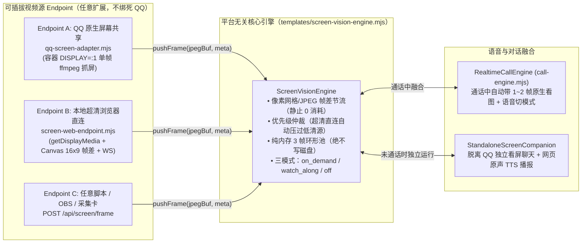

# Screen Vision Module — 平台无关的 AI 实时看屏与陪聊模块

> **文档定位**：将「实时看屏」抽象为完全脱离 QQ 的独立内核，支持**一起看电影聊细节、看你打游戏当毒舌军师、共享桌面随时问答**；既可独立运行（浏览器打开网页推屏 + 直接听 AI 原声回复），也可与 [`realtime-call-module.md`](./realtime-call-module.md) 无缝融合（声走实时电话、画走 1080p 超清直连或 QQ 屏幕共享）。  
> **核心指标**：原生多模态看图（`deepseek-flash` `reasoningEffort: "off"`，零额外视觉 API 费用）、**单帧看图响应 ~1.3–2.5s**、画面静止 **0 推理消耗**、**纯内存 3 帧环形缓冲绝不落盘**、与通话守护共进程总内存仅 ~104 MB。  
> **模板文件**：[`templates/screen-vision-engine.mjs`](./templates/screen-vision-engine.mjs)（平台无关内核）、[`templates/screen-web-endpoint.mjs`](./templates/screen-web-endpoint.mjs)（Endpoint B：本地超清浏览器推屏端与 HTTP/WS API）、[`templates/qq-screen-adapter.mjs`](./templates/qq-screen-adapter.mjs)（Endpoint A：QQ 原生屏幕共享适配层）。

---

## 1. 架构总览（1 个平台无关内核 + 多端可插拔 Endpoint）



---

## 2. 核心设计亮点

### 2.1 平台无关核心：`templates/screen-vision-engine.mjs`
- **零外部依赖、零磁盘写入**：任何 Endpoint 只要调用 `screenEngine.pushFrame(jpegBuf, meta)` 即可接入；断开连接、停止共享或切换 `mode = 'off'` 时瞬间清空内存全部帧引用。
- **双层防浪费节流**：
  1. 推帧时优先用客户端传入的 16×9 亮度网格计算精确帧差（或自动退回 JPEG 结构差分），静止帧直接判为 `keyframe: false`、**0 多模态消耗**；
  2. 对话时记录 `_lastSentFrameId`，同一静止画面已送进对话上下文后绝不重复发图；但当用户问「刚才怎么了 / 刚过去那幕」时，自动从环形池取 `[前序关键帧, 最新帧]` **双帧对比**。
- **三种实时模式（语音口令与网页按钮双向同步）**：
  - **`on_demand`（随问随看 · 默认）**：你问画面细节或画面有新变化时自动附带 1–2 帧。
  - **`watch_along`（主动陪看 / 看打游戏模式）**：语音喊「开启陪看 / 跟我一起看 / 看我打游戏」即开启；画面显著变化且安静超过冷却期时，后台静默扫描——有槽点就主动冒一句 ≤22 字短评，画面平淡则输出 `[SILENT]` 绝不硬凑话。通话模式下同步小幅抬高 VAD 打断门槛（1.25×），降低电影对白误触发打断的概率。
  - **`off`（暂停看屏）**：立即停止接帧并清空内存。

### 2.2 Endpoint B：本地超清浏览器直连（`templates/screen-web-endpoint.mjs`）
- 挂载在 `qq-call.service` 同一个 `127.0.0.1:3300` HTTP 服务上（零新增进程、**严禁监听 `0.0.0.0`**），全接口强制校验 `console-token`。
- 浏览器访问 `http://localhost:3300/screen`（经 SSH 隧道映射到本地电脑）：
  - 原生 `getDisplayMedia` 精确选择单个电影播放器或游戏窗口（不暴露其他桌面）；
  - 支持 `720p 极速省流` / `1080p 超清看字幕和游戏卡牌小字` 切换；
  - **独立可用**：即使没打 QQ 语音电话，也能直接在网页里边推屏边提问，勾选「同步播报小鲸鲸语音」可直接在浏览器听到她用自己专属音色回复；
  - **通话融合**：若此时你正在跟她打 QQ 语音电话，推屏会自动融合进通话引擎——**声音走 QQ 电话、画面走 1080p 超清直连**，同时自动让低清晰的 Endpoint A 静默避让。

### 2.3 Endpoint A：QQ 原生屏幕共享适配层（`templates/qq-screen-adapter.mjs`）
- 通话期间自动监测容器 `DISPLAY=:1` 窗口变化（新建共享窗口或原 `360x640` 通话窗口展开），同时在 `qq-call-adapter.mjs` 中用 `xwininfo -id <wid>` 保护通话窗口变宽时不被误判挂断；
- 每次轻量单帧 `ffmpeg -f x11grab -frames:v 1` 抽取 960px JPEG，无僵尸进程残留；
- 提供 `GET /api/screen/qq-probe?token=<TOKEN>` 诊断接口，方便首次真机测试 QQ 屏幕共享时快速核对容器窗口几何与画面解码。

---

## 3. 日常使用方式（本地电脑一键直连）

1. 在本地 Mac/PC 开一条安全 SSH 端口转发（把远端 `127.0.0.1:3300` 映射到本机）：
   ```bash
   ssh -N -L 3300:127.0.0.1:3300 <YOUR_SSH_ALIAS>
   ```
2. 浏览器打开 `http://localhost:3300/screen`，粘贴服务器 `state/console-token` 点击「连接」；
3. 点「选择屏幕 / 窗口」，选中你的电影播放器或游戏窗口（如《KARDS》《杀戮尖塔》）：
   - **边打电话边看**：直接照常打 QQ 语音电话，开口聊就行，随时可语音喊「开启陪看模式」「安静看片」「别看屏幕了」；
   - **不打电话独立看**：直接在网页右侧聊天框提问，或切到「主动陪看吐槽」勾选语音播报。

---

## 4. 新环境部署与验收

1. 复制 `screen-vision-engine.mjs`、`screen-web-endpoint.mjs`、`qq-screen-adapter.mjs` 以及更新后的 `call-engine.mjs`、`qq-call-adapter.mjs` 到宿主 `src/` 目录，重启 `qq-call.service`；
2. 验收清单：
   ```bash
   ss -tlnp | grep 3300                                                # 必须仅监听 127.0.0.1:3300
   curl -s -o /dev/null -w "%{http_code}\n" http://127.0.0.1:3300/api/screen/status  # 未带 token 必须返回 401
   curl -s http://127.0.0.1:3300/health                                # 返回含 screen 状态对象
   # 带 token 推送同一张 JPEG 两次：第 1 次 keyframe=true，第 2 次 keyframe=false (changeScore=0)
   # 调用 POST /api/screen/ask 提问画面内容：约 1.3~2.5s 返回准确口语描述
   # 切换 mode=off 后检查 status：active=false, keyframesBuffered=0
   ```

---

## 5. 实战踩坑与调优速查（QQ 容器屏幕共享实测沉淀）

| 序号 | 真实遇到的问题 | 根因 | 最终稳健解法 |
| --- | --- | --- | --- |
| 1 | 直接点 QQ「屏幕共享」一直显示未接听 | 屏幕共享邀请是 **`350x160` 弹窗**（「XX正邀请你加入屏幕共享」，拒绝 `+209,+124` / 加入 `+295,+124`），与 `360x640` 语音来电窗不同 | `qq-call-adapter.mjs` 同时轮询 `360x640` 与 `350x160` 弹窗，对 `350x160` 做同样白名单多模态校验后再点「加入」，空闲直开与通话中途升级均支持 |
| 2 | 点击「加入」2 秒后自动退出语音引擎 | LinuxQQ 在点「加入」前已预创建 `"屏幕共享"` WID，且容器默认 ASCII locale 导致 `xwininfo` 中文标题乱码，误判未弹出窗口 | 所有 `xwininfo` 命令强制加 `LC_ALL=C.UTF-8`，通过 `findVisibleShareWindow()` 按标题 `"屏幕共享"` + `Map State: IsViewable` 精准锁窗 |
| 3 | 共享画面发黑 / 雪花，弹窗报「显示驱动不兼容」 | 容器默认给 LinuxQQ 传了 `--disable-gpu --disable-software-rasterizer --disable-gpu-compositing`，禁死了 Electron 内置的 SwiftShader 软件 WebGL | 改 `/etc/supervisord.conf` 中 `qq` 启动参数为 `--no-sandbox --use-gl=angle --use-angle=swiftshader --enable-unsafe-swiftshader --enable-webgl --ignore-gpu-blocklist --disable-dev-shm-usage` 并用 `supervisorctl update qq` 热重启（免扫码自动重登） |
| 4 | 开着游戏 BGM（如雪人兄弟）时突然卡住几十秒不说话 | 游戏 BGM 混入共享音频，持续高于 VAD 阈值导致录音卡满 25 秒才超时，并反复取消 AI 在途回复 | `call-engine.mjs` 加入 **ASR 辅助断句**（识别文字停顿 1.15s 即判说完，无视持续 BGM）+ **2.4s 纯 BGM 静默丢弃并自适应抬高底噪至 1100** + 思考期提高打断帧数门槛 |
| 5 | 共享画面期间偶发网络感音频卡顿、越聊越慢 | SwiftShader 软渲 + 每 1.5s 抓 960px 帧拉高 CPU 抢占 `pacat`；且每句短搭话都重复附带截图拖慢大模型 | 抓屏改为 `nice -n 15 ffmpeg`、`2.8s` 间隔、`768px` `-q:v 7`，并在 **AI 说话期间暂停抓屏**；`pacat` 缓冲增至 `160ms`（节拍器预充 `120ms`）；非视觉短搭话 9 秒内跳过重复附帧 |

