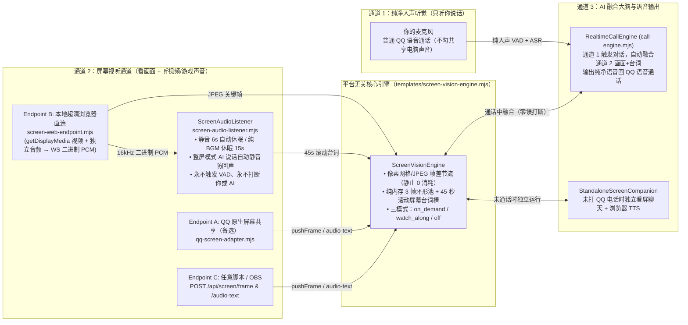

# Screen Vision Module — 平台无关的 AI 实时看屏与陪聊模块

> **文档定位**：将「实时看屏 + 听屏」抽象为完全脱离 QQ 的独立内核，采用**物理三通道分离架构**（通道 1 纯净人声麦 + 通道 2 1080p 画面与独立屏幕音轨 + 通道 3 AI 发声），支持**一起看电影聊台词细节、看你打游戏当毒舌军师、共享桌面随时问答**；既可独立运行（浏览器打开网页推屏 + 直接听 AI 原声回复），也可与 [`realtime-call-module.md`](./realtime-call-module.md) 无缝融合（声走普通 QQ 语音电话、画与视频音频走 1080p 超清直连）。  
> **核心指标**：原生多模态看图（`deepseek-flash` `reasoningEffort: "off"`，零额外视觉 API 费用）、**单帧看图响应 ~1.3–2.5s**、画面静止 **0 推理消耗**、屏幕静音 **0 听译费用**、**画面与屏幕台词纯内存环形缓冲绝不落盘**、与通话守护共进程总内存仅 ~104 MB。  
> **模板文件**：[`templates/screen-vision-engine.mjs`](./templates/screen-vision-engine.mjs)（平台无关视觉+台词内核）、[`templates/screen-audio-listener.mjs`](./templates/screen-audio-listener.mjs)（通道 2 独立屏幕音轨后台静默听译器）、[`templates/screen-web-endpoint.mjs`](./templates/screen-web-endpoint.mjs)（Endpoint B：本地超清浏览器推屏/推音端与 HTTP/WS API）、[`templates/qq-screen-adapter.mjs`](./templates/qq-screen-adapter.mjs)（Endpoint A：QQ 原生屏幕共享适配层）。

---

## 1. 架构总览（物理三通道分离 + 1 个平台无关内核）



---

## 2. 核心设计亮点

### 2.1 平台无关核心：`templates/screen-vision-engine.mjs`
- **零外部依赖、零磁盘写入**：任何 Endpoint 只要调用 `screenEngine.pushFrame(jpegBuf, meta)` 即可接入；断开连接、停止共享或切换 `mode = 'off'` 时瞬间清空内存全部帧引用。
- **双层防浪费节流**：
  1. 推帧时优先用客户端传入的 16×9 亮度网格计算精确帧差（或自动退回 JPEG 结构差分），静止帧直接判为 `keyframe: false`、**0 多模态消耗**；
  2. 对话时记录 `_lastSentFrameId`，同一静止画面已送进对话上下文后绝不重复发图；但当用户问「刚才怎么了 / 刚过去那幕」时，自动从环形池取 `[前序关键帧, 最新帧]` **双帧对比**。
- **三种实时模式（语音口令与网页按钮双向同步）**：
  - **`on_demand`（随问随看 · 默认）**：你问画面细节或画面有新变化时自动附带 1–2 帧。
  - **`watch_along`（主动陪看 / 看打游戏模式）**：语音喊「开启陪看 / 跟我一起看 / 看我打游戏」即开启；画面显著变化且安静超过冷却期时，后台静默扫描——有槽点就主动冒一句 ≤22 字短评，画面平淡则输出 `[SILENT]` 绝不硬凑话。通话模式下同步小幅抬高 VAD 打断门槛（1.25×），降低电影对白误触发打断的概率。
  - **`off`（暂停看屏）**：立即停止接帧并清空内存。

### 2.2 通道 2 独立屏幕音轨：`templates/screen-audio-listener.mjs`
- **物理隔离、零误打断**：浏览器推屏端用 `getDisplayMedia({ video, audio })`（关闭回声消除/降噪以免扭曲电影声音）通过 Web Audio 实时重采样为 16kHz Int16LE 单声道 PCM，以 **WebSocket 二进制帧**直推本模块；**绝不触碰通道 1 的 VAD、打断判定或底噪阈值**。
- **45 秒纯内存滚动台词槽**：后台 Paraformer 实时听译出的视频旁白/台词写入 `ScreenVisionEngine` 的 45 秒滚动内存缓冲（最多保留最近 420 字），在你开口说话或主动陪看吐槽时作为背景上下文自动注入大模型；断开或静音时瞬间清空、绝不落盘。
- **四重省流与防回声保护**：
  1. **静音休眠**：视频暂停/静音超过 6 秒自动关闭 ASR 连接（0 额外费用）；
  2. **纯音乐/游戏 BGM 保护**：连续 12 秒有声但 0 字识别自动休眠 15 秒；
  3. **整屏系统音频防回声**：若浏览器捕获的是整个屏幕（`surface !== 'browser'`），AI 说话期间自动对屏幕音轨填静音，防止 AI 自身声音混入屏幕台词；共享单个浏览器标签页（B 站 / YouTube 等）则天然完全隔离；
  4. **长视频无感轮换**：连续听译满 4.5 分钟自动平滑轮换会话，永不触碰单连接时长上限。
- 语音或网页均可随时开关屏幕音轨（喊「别听屏幕声音了 / 别听解说」或「打开屏幕声音」）。

### 2.3 Endpoint B：本地超清浏览器直连（`templates/screen-web-endpoint.mjs`）
- 挂载在 `qq-call.service` 同一个 `127.0.0.1:3300` HTTP 服务上（零新增进程、**严禁监听 `0.0.0.0`**），全接口强制校验 `console-token`。
- 浏览器访问 `http://localhost:3300/screen`（经 SSH 隧道映射到本地电脑）：
  - 原生 `getDisplayMedia` 精确选择电影标签页、游戏窗口或整个屏幕，勾选浏览器弹窗底部的「分享音频 / 分享系统音频」即可同时开启通道 2 独立音轨；
  - 界面内置画面变化条、通道 2 独立音频电平条、一键静音屏幕音轨按钮，以及**实时滚动台词预览条**；
  - 支持 `720p 极速省流` / `1080p 超清看字幕和游戏卡牌小字` 切换；
  - **通话融合（物理三通道 · 推荐）**：打通普通 QQ 语音电话后网页状态自动亮起「已融合 QQ 语音（三通道）」——通道 1 只听你说话（零 BGM 误打断）、通道 2 独立看 1080p 画面并听视频台词、通道 3 走 QQ 语音播报回复且免除 LinuxQQ 200% CPU 软渲染；
  - **独立可用**：未打 QQ 电话时也能在网页直接提问或主动陪看，勾选「同步播报小鲸鲸语音」可直接在浏览器发声。

### 2.4 Endpoint A：QQ 原生屏幕共享适配层（`templates/qq-screen-adapter.mjs`）
- 通话期间自动监测容器 `DISPLAY=:1` 窗口变化（支持空闲直开 `350x160` 屏幕共享邀请与通话中途升级），用 `LC_ALL=C.UTF-8` + `IsViewable` 精准锁窗；
- 每次轻量单帧 `nice -n 15 ffmpeg -f x11grab -frames:v 1` 抽取 768px JPEG，并在 AI 说话期间暂停抓屏；
- **单轨混合提示**：用 QQ 原生屏幕共享看带旁白/解说的视频时，建议取消勾选 QQ 里的「共享电脑声音」（只看画面与字幕）；如需同时听清解说又零误打断，推荐使用上面的 **Endpoint B 物理三通道**。
- 提供 `GET /api/screen/qq-probe?token=<TOKEN>` 诊断接口，方便真机测试核对容器窗口几何与画面解码。

---

## 3. 日常使用方式（物理三通道一键直连）

1. 在本地 Mac/PC 开一条安全 SSH 端口转发（把远端 `127.0.0.1:3300` 映射到本机）：
   ```bash
   ssh -N -L 3300:127.0.0.1:3300 <YOUR_SSH_ALIAS>
   ```
2. 浏览器（推荐 Chrome / Edge）打开 `http://localhost:3300/screen`，粘贴服务器 `state/console-token` 点击「连接」；
3. 点「选择屏幕 / 标签页」，选中你的电影标签页或游戏窗口/整个屏幕，并**勾选弹窗底部的「分享音频」**：
   - **边打电话边看（物理三通道，推荐戴耳机）**：正常给小鲸鲸打**普通 QQ 语音电话**（不用点 QQ 屏幕共享），网页右上角会自动变为「已融合 QQ 语音（三通道）」。你直接开口聊，电影/游戏解说自动走通道 2 台词条，随时可语音喊「开启陪看模式」「安静看片」「别听屏幕声音了」「别看屏幕了」；
   - **不打电话独立看**：直接在网页右侧聊天框提问，或切到「主动陪看吐槽」勾选语音播报。

---

## 4. 新环境部署与验收

1. 复制 `screen-vision-engine.mjs`、`screen-audio-listener.mjs`、`screen-web-endpoint.mjs`、`qq-screen-adapter.mjs` 以及更新后的 `call-engine.mjs`、`qq-call-adapter.mjs` 到宿主 `src/` 目录，重启 `qq-call.service`；
2. 验收清单：
   ```bash
   ss -tlnp | grep 3300                                                # 必须仅监听 127.0.0.1:3300
   curl -s -o /dev/null -w "%{http_code}\n" http://127.0.0.1:3300/api/screen/status  # 未带 token 必须返回 401
   curl -s http://127.0.0.1:3300/health                                # 返回含 screen.audio 状态对象
   # 带 token 推送同一张 JPEG 两次：第 1 次 keyframe=true，第 2 次 keyframe=false (changeScore=0)
   # 通过 WS 二进制帧推 16kHz 中文 PCM：服务端自动唤醒通道 2 听译，回传 screen_audio 事件并写入 45s 台词槽
   # 调用 POST /api/screen/ask 提问视频台词与画面：约 1.3~2.5s 结合画面+台词准确回答
   # 切换 mode=off 后检查 status：active=false, keyframesBuffered=0, audio.bufferedLines=0
   ```

---

## 5. 实战踩坑与调优速查（QQ 容器与三通道实测沉淀）

| 序号 | 真实遇到的问题 | 根因 | 最终稳健解法 |
| --- | --- | --- | --- |
| 1 | 直接点 QQ「屏幕共享」一直显示未接听 | 屏幕共享邀请是 **`350x160` 弹窗**（「XX正邀请你加入屏幕共享」，拒绝 `+209,+124` / 加入 `+295,+124`），与 `360x640` 语音来电窗不同 | `qq-call-adapter.mjs` 同时轮询 `360x640` 与 `350x160` 弹窗，对 `350x160` 做同样白名单多模态校验后再点「加入」，空闲直开与通话中途升级均支持 |
| 2 | 点击「加入」2 秒后自动退出语音引擎 | LinuxQQ 在点「加入」前已预创建 `"屏幕共享"` WID，且容器默认 ASCII locale 导致 `xwininfo` 中文标题乱码，误判未弹出窗口 | 所有 `xwininfo` 命令强制加 `LC_ALL=C.UTF-8`，通过 `findVisibleShareWindow()` 按标题 `"屏幕共享"` + `Map State: IsViewable` 精准锁窗 |
| 3 | 共享画面发黑 / 雪花，弹窗报「显示驱动不兼容」 | 容器默认给 LinuxQQ 传了 `--disable-gpu --disable-software-rasterizer --disable-gpu-compositing`，禁死了 Electron 内置的 SwiftShader 软件 WebGL | 改 `/etc/supervisord.conf` 中 `qq` 启动参数为 `--no-sandbox --use-gl=angle --use-angle=swiftshader --enable-unsafe-swiftshader --enable-webgl --ignore-gpu-blocklist --disable-dev-shm-usage` 并用 `supervisorctl update qq` 热重启（免扫码自动重登） |
| 4 | 开着游戏 BGM（如雪人兄弟）时突然卡住几十秒，或底噪抬太高听不见人说话 | 持续 BGM 占满 25 秒 VAD 录音；若底噪上限放得过高（如 `2200`）又会把开口门槛抬到 `6900` 导致听不见真人 | `call-engine.mjs` 加入 **ASR 辅助断句**（停顿 1.15s 即判说完）+ **2.4s 纯 BGM 静默丢弃**，同时严格把底噪上限封顶在 **`≤600 / 650`**；物理三通道（`web-direct`）模式下通道 1 恢复 100% 原始高灵敏度 |
| 5 | 共享画面期间出现“网络不好式”语音卡顿 | 一方面 SwiftShader 软渲占 200% CPU 抢占 PulseAudio，另一方面 `pacat` 缓冲区若大于节拍器预充且首包 30ms 直接开播会导致反复欠载 | `call-engine.mjs` 节拍器加入 `_ttsStreaming` 门控与 **`180ms` 水库预充**（严格大于 `pacat --latency-msec=100`）；宿主机侧对 `pulseaudio` / `AudioService` `renice -n -10`、对 QQ 软渲进程 `renice -n 15`；物理三通道模式完全绕开 LinuxQQ 软渲，从根源消灭卡顿 |
| 6 | QQ 共享带解说的视频时，解说词被当成主人在说话、频频打断 AI | QQ 客户端在发送前就把麦克风与电脑声音混成 1 条音轨，服务端无法区分真人还是旁白 | 升级**物理三通道（路线 A）**：通道 1 走普通 QQ 语音（只传麦），通道 2 走 Endpoint B 浏览器独立推送 1080p 画面 + 二进制屏幕音频，后台静默听译进 45 秒台词槽，永不触发 VAD/打断；若用纯 QQ 共享看解说视频，取消勾选「共享电脑声音」即可 |
| 7 | 公网浏览器切到后台或全屏看视频后，AI 看到的画面滞后数十秒甚至 1~2 分钟 | 三重叠加：① Chrome 对后台标签页的 `setInterval` 限频且暂停 `<video>` 解码重绘；② 默认 `1280px q=0.78`（~250KB/s）在公网窄带宽下未做背压丢帧，旧帧在 WS 缓冲里堆积成队；③ 开口提问时没有主动抓此刻瞬时帧 | 浏览器推屏端改用 **Web Worker 后台防限频定时器 + `ImageCapture.grabFrame()` 直接抓流**（后台/全屏不冻结）+ **`ws.bufferedAmount > 32KB` 严格背压跳帧** + 默认 `960px q=0.62`（~45KB/帧提速 5×）；服务端在用户刚开口时主动下发 `{ type: "snap_now" }` 即时抓帧并用 `capturedAt` 丢弃乱序陈旧帧，画面滞后压至 `<1s` |

