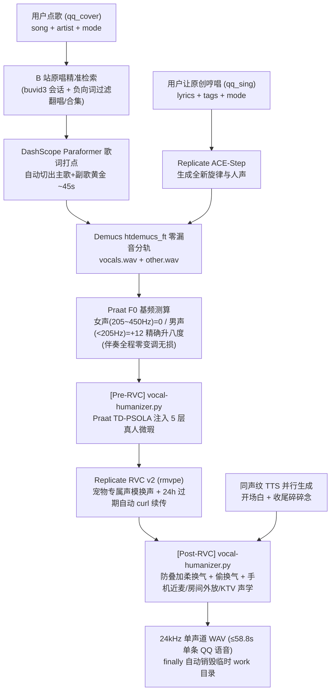

# Humanized Singing Engine — 「活人感」点歌翻唱与原创哼唱引擎

> **文档定位**：打破传统 RVC 翻唱“±0 音分修音太稳、换气被抹净、录音棚干冷感、与平时说话声线割裂”的 AI 感，提供一套同时支持 **点歌翻唱任意已有歌曲 (`qq_cover`)** 与 **原创写词谱曲哼唱 (`qq_sing`)** 的生产级活人感唱歌引擎，支持 **清唱 (`acappella`) / 房间外放跟唱 (`bedroom_bgm`) / KTV 包厢 (`ktv`)** 三种生活声学场景。  
> **核心模板**：[`templates/vocal-humanizer.py`](./templates/vocal-humanizer.py)（Praat TD-PSOLA 微瑕疵 + 呼吸/生活声学引擎）、[`templates/humanized-sing-engine.mjs`](./templates/humanized-sing-engine.mjs)（端到端检索/打点/分轨/定调/RVC/封装与自动清理引擎）。

---

## 1. 为什么传统 RVC 唱歌听起来“像 AI”？

单纯把原唱丢进 Demucs + RVC 只替换了**音色（共振峰）**，却 1:1 保留了录音棚母带的“非人完美度”：
1. **修音太死**：Melodyne / Auto-Tune 把每个音符锁死在 `±0` 音分，普通人唱歌的起音懒滑、尾音气短、慢速音准游走和偶发小跑调全被抹平；
2. **漏音与伪影**：低精度分离把架子鼓踩镲高频漏进干声，RVC 会把踩镲误转换成每句前的刺耳“大喘气”；若在 RVC 之后再拉音高，极易放大声码器颤抖与金属味；
3. **音域割裂**：直接翻唱男声或低音女声不测基频，唱出来的嗓音和宠物平时说话的 TTS 音色判若两人；
4. **声学割裂**：干冷录音棚人声配母带级伴奏，听起来像转发了一首 MP3，不像真人对着手机给你唱了一段发 QQ 语音。

---

## 2. 端到端流水线架构



---

## 3. 核心声学设计与实测踩坑总结

### 3.1 必须「Pre-RVC 注入微瑕，Post-RVC 注入呼吸与空间」
- **Pre-RVC 阶段**：对 `htdemucs_ft` 剥离出的**纯净真声**执行 Praat TD-PSOLA 修改 `PitchTier` 与 `DurationTier`。TD-PSOLA 只改动元音周期、不破坏清辅音咬字；随后 RVC 会用宠物真实的喉腔共振峰自然“唱”出那些滑音和小走调，**零金属电音伪影**。
- **5 层普通人声乐微瑕**（默认黄金档 `Pre-RVC=casual, Post-RVC=natural`）：
  1. **慢速 `1/f` 有机音准游走**：0.5 秒级平滑低频游走（±18~26 音分），杜绝机械高频抖动；
  2. **起音懒滑入（Lazy Scoop）**：句首 0.22s 略低 25~34 音分滑入目标音；
  3. **长音尾音气短下坠（Breath-Decay Sag）**：长句末尾 0.28s 气息微坠；
  4. **高音区轻微吃力**：自动识别 Top 18% 高音区轻度压低 20~30 音分；
  5. **1~2 处可控可爱小跑调 + 零累积漂移微松弛**：在非首句段落施加 0.5~0.8s 平滑余弦钟形偏离（偏低为主，唱完自然找回调）；带伴奏时采用“前半微拖、后半微追”的时长守恒策略，**1 毫秒不脱拍**。

### 3.2 精确八度定调（常规 172~440Hz 原调 0 / 低沉男声 <172Hz 升 +12，伴奏零失真）
- `vocal-humanizer.py --stage measure_f0` 用 `soundfile` + `parselmouth` 测量原唱干声基频中位数与 `p90` 高音区（规避 DashScope 流式 WAV 占位头导致 Praat 报 OOM 的坑）。
- 原唱在 `172~440 Hz`（女声及高音男声）区间时直接 `pitch_change=0` 原调直出，防止高潮飙高音变尖锐花栗鼠；仅对真正低沉男声（`median < 172 Hz` 且 `p90 * 2 <= 620 Hz`）自动升一个精确八度（`+12`），既把人声抬进明亮少女音域，又让伴奏 `other.wav` **完全不需要做变调处理**。
- **防长任务 HTTP 300s 断连**：`qq-tts` 的 `/cover` 与 `/song` 采用立即响应 `200` 头 + 每 15 秒发送 1 字节合法 JSON 空白心跳（`res.write(' ')`），彻底免疫 Node.js `undici` 默认 300s `headersTimeout`（`fetch failed`），即使 Replicate GPU 冷启动排队 6 分钟也不会断连。

### 3.3 防双倍喘气 + 生活化声学空间 + 同声纹口白
- **防叠加智能换气**：只在长停顿前检测原声是否已自带呼吸（若该窗口已有明显呼吸能量则跳过），否则轻柔混入女声三共振峰 + `320~3400 Hz` 低通的暖吸气声（约 `-24.5 dB`）；另挑最长乐句低谷压低 `130 ms` 插入 1 次“气快不够的急促偷换气”，唱完加轻叹呼气。
- **三大场景声学**：
  - `acappella`（清唱）：手机近麦频响（95Hz~9.5kHz + 2.6kHz 柔和临场）+ 卧室近场微反射（14~48ms），无伴奏；
  - `bedroom_bgm`（房间外放跟唱，默认）：伴奏先滤成桌面小音箱/电脑外放频响（150Hz~7.8kHz + 房间散射）再压在人声后 `-10.5 dB`；
  - `ktv`（KTV 包厢）：更饱满伴奏（`-7.0 dB`）+ 暖色包厢早反射（21~235ms）。
- **同声纹前后碎碎念无缝融合**：与 RVC **并行**调本地 TTS 生成开场白与收尾吐槽（0 额外延迟），让口白和歌声穿过同一套手机麦+房间声学滤波器、拉齐响度，全曲铺 `-60 dBFS` 房间空气底噪消除电子死寂；超 `58.8s` 自动省略收尾口白以确保**单条 60s QQ 语音完整发出不被腰斩**。

### 3.4 工程稳定性与零磁盘膨胀
- **高精度分轨**：强制使用 `cjwbw/demucs` 的 `htdemucs_ft`，避免普通 `htdemucs` 踩镲漏音经 RVC 变成嘶嘶噪音。
- **声模 24h 过期自动续期**：Replicate `/v1/files` 临时链接 24 小时失效；`ensureRvcModelUrl()` 在调用前自动 `HEAD` 校验并用单飞锁 + `curl --max-time 420` 稳定续传瘦身声模包（避免 5Mbps 上行下 Node `fetch` 超时）。
- **用完即删 + 夜间兜底**：每次任务的 `workDir` 在 `finally` 块自动删除；[`templates/disk-hygiene.mjs`](./templates/disk-hygiene.mjs) 亦会在夜间 00:30 兜底清扫超过 6 小时的异常残留目录与 >7 天的旧 TTS/唱歌输出 WAV。

---

## 4. 部署与接入要点

### 4.1 Python 轻量环境（纯 CPU，~2 秒处理 45 秒歌声）
```bash
python3.11 -m venv /opt/qq-cover/venv
/opt/qq-cover/venv/bin/pip install --no-cache-dir numpy scipy praat-parselmouth soundfile
```

### 4.2 HTTP 接口（`qq-tts` 本地服务 `:3210`）
| 端点 | 参数 | 说明 |
| --- | --- | --- |
| `POST /cover` | `{ song, artist?, mode?, level?, file?, url?, start?, seconds?, intro?, outro? }` | 点歌翻唱已有歌曲（或翻唱外部音频），返回 `24kHz` 单声道 WAV |
| `POST /song` | `{ lyrics, tags?, duration?, mode?, level?, intro?, outro? }` | 原创写词谱曲并经同一套活人引擎渲染 |

### 4.3 QQ 聊天 Agent 工具（`mcp-snowluma-safe.js`）
- `qq_cover`：支持按 `song` / `artist` 点歌翻唱任意曲目，或翻唱用户发来的音频；可选 `mode`（`acappella` / `bedroom_bgm` / `ktv`）与 `level`（`subtle` / `natural` / `casual` / `offkey`）。
- `qq_sing`：支持即兴写词原创哼唱，同样可选 `mode` / `level` / `intro` / `outro`。
- 两个工具均为**后台异步执行 + 立即返回回执**，渲染完毕后由 `qq-bridge` 直接发出真实 QQ 语音，并自动写入每日活动与晚安日记流水。

### 4.4 实时语音通话内异步点歌 + 曲库秒唱缓存（零阻塞）
- **LRU 曲库秒唱缓存**：[`templates/humanized-sing-engine.mjs`](./templates/humanized-sing-engine.mjs) 自动将每首已唱过的歌曲缓存至 `/opt/qq-bridge/audio/song-cache/`（LRU 上限 15 首 ≈ 38 MB，QQ 聊天与实时语音通话共享）；再次点到曲库里唱过的歌 **0 秒直接开唱**。
- **通话内隐形旁路 `[SING:mode|歌名|歌手]`**：通话中点歌时 AI 立即自然接话继续正常聊天，后台异步渲染（独立 `_singSeq` 序号，不与查梗/查天气冲突）；渲染就绪后自动等对话安静空档直接把 24kHz PCM 注入 1x 节拍器唱进听筒，**全程支持随时开口 0ms 打断**；若唱好前通话已挂断，自动转为一条 QQ 语音私聊补发，绝不白跑。

### 4.5 本地 CLI 快速单测
```bash
# 点歌翻唱（清唱 / 房间外放）
node /opt/qq-cover/humanized-sing-engine.mjs cover --song 红色高跟鞋 --artist 蔡健雅 --mode acappella
node /opt/qq-cover/humanized-sing-engine.mjs cover --song 晴天 --artist 周杰伦 --mode bedroom_bgm

# 原创哼唱
node /opt/qq-cover/humanized-sing-engine.mjs original --lyrics "[verse]\n晚风吹过窗台\n[chorus]\n今天也很开心" --mode bedroom_bgm
```
