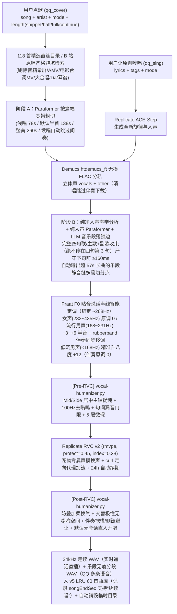

# Humanized Singing Engine — 「活人感」点歌翻唱与原创哼唱引擎

> **文档定位**：打破传统 RVC 翻唱“±0 音分修音太稳、换气被抹净、录音棚干冷感、与平时说话声线割裂”的 AI 感，提供一套同时支持 **点歌翻唱任意已有歌曲 (`qq_cover`)** 与 **原创写词谱曲哼唱 (`qq_sing`)** 的生产级活人感唱歌引擎，支持 **清唱 (`acappella`) / 房间外放跟唱 (`bedroom_bgm`) / KTV 包厢 (`ktv`)** 三种生活声学场景。  
> **核心模板**：[`templates/vocal-humanizer.py`](./templates/vocal-humanizer.py)（Praat TD-PSOLA 微瑕疵 + 呼吸/生活声学引擎）、[`templates/humanized-sing-engine.mjs`](./templates/humanized-sing-engine.mjs)（端到端检索/打点/分轨/定调/RVC/封装与自动清理引擎）。

---

## 1. 为什么传统 RVC 唱歌听起来“像 AI”？

单纯把原唱丢进 Demucs + RVC 只替换了**音色（共振峰）**，却 1:1 保留了录音棚母带的“非人完美度”：
1. **修音太死**：Melodyne / Auto-Tune 把每个音符锁死在 `±0` 音分，普通人唱歌的起音懒滑、尾音气短、慢速音准游走和偶发小跑调全被抹平；
2. **漏音与伪影**：低精度分离把架子鼓踩镲高频漏进干声，RVC 会把踩镲误转换成每句前的刺耳“大喘气”；若在 RVC 之后再拉音高，极易放大声码器颤抖与金属味；
3. **音域割裂**：直接翻唱男声或低音女声不测基频，唱出来的嗓音和宠物平时说话的 TTS 音色判若两人；
4. **声学割裂**：干冷录音棚人声配母带级伴奏，听起来像转发了一首 MP3，不像真人对着手机给你唱了一段发 QQ 语音。

---

## 2. 端到端流水线架构



---

## 3. 核心声学设计与实测踩坑总结

### 3.1 两阶段「音乐段落锁边（Stanza-Complete）」与四档篇幅/续唱（根治半句硬切 & 四句第 3 句腰斩 & 只唱二三十秒）
- **为什么仅靠声学停顿还会停在四句段落的第 3 句？**
  - 混音状态下轻声民谣前 1~2 字易漏识；即便分轨后只看纯能量静音缝，四句联的第 3 句尾也常有 0.7s 换气，容易被纯秒数惩罚误选为终点，让人听起来“没唱完就断了”。
- **V5 两阶段段落锁边方案**：
  1. **阶段 A（按篇幅宽裕粗切）**：支持四种篇幅 `length`：
     - `snippet`（浅唱一段，~36–55s，单条 QQ 语音装下 1 个完整乐段）；
     - `half`（**默认唱半首**，~65–118s，唱完完整主歌 + 导歌 + 第一遍完整副歌，在进间奏前收尾）；
     - `full`（唱完整一首，~140–250s，覆盖全曲起止）；
     - `continue`（**无缝续唱**：“继续唱/接着往后唱”时从上一首精确 `songEndSec` 往后扫描，自动跳过 15–30s 间奏直奔下一完整乐段！）。
  2. **阶段 B（Demucs 纯净人声轨 10ms 声学边界 + 纯人声 Paraformer + LLM 音乐段落定剪）**：
     - 先用 `vocal-humanizer.py --stage find_window` 在零伴奏 `vocals.wav` 上提取精确 10ms 乐句边界、逐句 HNR / F0 跳变率 / 立体声宽度（识别多人合唱混沌段）；
     - 再对**零伴奏纯净 `vocals.wav`** 跑 Paraformer 获取高准确度歌词时间轴，交由轻量 LLM（`qwen-plus-latest`, `enable_thinking: false`, ~0.6s）结合语义、韵脚与停顿时长选定**完整四句联 / 完整主副歌**起止句号（绝不停在四句第 2/3 句），再映射回 10ms 精确声学边缘（严守 `trim_end <= next_phrase_start - 0.16s`，数学上绝不漏唱下句半个字）；
     - 若总时长 `>57.5s`：实时语音通话直接播连续整段 WAV；QQ 聊天自动按**乐段/乐句静音缝**拆成多条 ≤55s 语音条（附 50ms 柔淡入淡出防爆音），**每条语音都起于完整句首、止于完整句尾，绝不字中硬切**！
     - 若 ASR/LLM 不可用，自动回退声学降级算法（对 ≥2.2s 进间奏长停顿与 4 句/8 句偶数乐段结构高权重加分）。

### 3.2 立体声 Mid/Side 主唱提纯 + Pre-RVC 真人微瑕
- **Mid/Side 维纳居中主唱提纯**：商业立体声混音中主唱严格居中（`M = (L+R)/2`），而大混响、宽声场和声/双人重唱及乐器漏音多分布在侧信号（`S = (L-R)/2`）。在 Pre-RVC 前先通过 STFT 软维纳掩码 `|M|² / (|M|² + 1.85|S|²)` 提纯干声，并配合 `100 Hz` 4 阶高通与 `-16 dB` 句间柔和门限，大幅消除多人合唱干扰与句间嗡鸣底噪。
- **Pre-RVC 注入 5 层普通人微瑕**：先对纯净干声执行 Praat TD-PSOLA 修改 `PitchTier` / `DurationTier`（只改元音周期、零损伤清辅音），再喂给 RVC（`protect=0.45` 保咬字、`index_rate=0.28` 去金属嗡声、`rms_mix_rate=0.32`）：
  1. 慢速 `1/f` 有机音准游走（±18~26 音分，0.5s 平滑窗口）；
  2. 起音懒滑入（句首 0.22s 略低滑入）；
  3. 长音尾音气短下坠（句尾 0.28s 微微掉气）；
  4. 高音区轻微吃力（Top 18% 高音微扁 20~30 音分）；
  5. 1~2 处可控可爱小跑调 + 伴奏时长严格守恒的句内微松弛（1ms 不脱拍）。

### 3.3 贴合说话声线的智能定调 + `rubberband` 伴奏同步移调（解决男声歌音调过低不像本人！）
- 实测宠物平时说话 TTS 的基频黄金区在 **`~268 Hz`**（`p25=238 Hz`, `p75=313 Hz`）。旧版只支持 `{0, +12}` 二选一，导致大量 `168–231 Hz` 的流行男声（如周杰伦、许嵩、校园民谣等）被迫原调 `0` 演唱，发声落到低沉女中低音区，与平时明快少女说话声线差距偏大。
- **V5 连续半音 KTV 女声升调策略（`vocal-humanizer.py --stage measure_f0 --mode <mode>`）**：
  - **女声/女中音 (`232~435 Hz`)**：`vocal_shift = 0, bgm_shift = 0`（原调直出，零变调）；
  - **低沉男中低音 (`<168 Hz` 且 `p90 × 2 <= 575 Hz`)**：`vocal_shift = +12, bgm_shift = 0`（精准升一个八度，伴奏原调零失真）；
  - **流行男声/男高音 (`168~231 Hz`)**：按 `round(12 × log2(272 / med))` 计算目标半音（带伴奏封顶 `+6`，清唱最高 `+8`，并严守高音上限 `p90 × 2^(s/12) <= 525 Hz` 防尖锐），将人声精准抬回她 **~268 Hz 平时说话黄金音区**；同时用专业级 **`ffmpeg rubberband`**（`formant=preserved:pitchq=quality:transients=crisp:channels=together`）对分离出的伴奏 `other.wav` 做 1:1 原速同步移调，和声零跑调、乐器零变味！
- **防长任务 HTTP 300s 断连**：`qq-tts` 的 `/cover` 与 `/song` 采用 `streamLongJson`——立即响应 `200` 头 + 每 15 秒发送 1 字节合法 JSON 空白心跳（`res.write(' ')`），彻底免疫 Node.js `undici` 默认 300s `headersTimeout`（`fetch failed`），实测 Replicate 冷启动排队超 7 分钟仍稳定交付。

### 3.4 零嗡鸣生活化声学 + 人声侧链避让 + 默认无套话直入开唱
- **彻底消灭低中频“嗡嗡声”**：
  - 人声总线：`110 Hz` 高通 + `280 Hz` (`-2.5 dB`) 去浑浊凹槽 + `2.8 kHz` (`+1.8 dB`) 清晰临场；房间早反射先过 **`380 Hz` 高通**并采用**正负极性交替质数延迟抽头**，彻底消灭同相梳状滤波产生的盒子嗡鸣。
  - 伴奏总线：`bedroom_bgm` 切掉 `220 Hz` 以下轰鸣，精准在 `350 Hz (-3.5 dB)` 与 `2.4 kHz (-3.0 dB)` 挖出人声频段凹槽；用**分帧 `P75` 响度**对齐电平（防止安静前奏拉爆副歌音量），默认 `bedroom_bgm = -12.8 dB` / `ktv = -9.2 dB`，并叠加 **`-2.5 dB` 柔和人声侧链避让**（唱歌时伴奏轻柔退让、句间停顿自然回升）。
- **防叠加柔换气**：上限随歌曲时长线性扩展（每 ~9.5s 最多 1 次）、仅在 `≥0.36s` 真实停顿且原声无自带呼吸处混入 `-25.8 dB` 暖气声。
- **默认零套话直入开唱（`framing: false`）**：取消每次固定硬塞的“我找下伴奏/凑合听吧”口白模板——无论 QQ 语音还是实时电话都直接以 `0.55s` 柔和伴奏淡入（清唱留 `0.10s` 自然气口）直接开唱，尾段伴奏 `0.90s` 柔淡出 + `0.18s` 柔收尾，彻底告别复读机感（仅当显式传入自定义 `intro`/`outro` 时才按需拼入口白）。

### 3.5 工程稳定性、选源避坑与零磁盘膨胀
- **精选金曲直连目录 + B 站原唱精准避坑**：优先命中预筛 118 首纯净原唱目录 [`curated-songs-catalog.json`](./curated-songs-catalog.json)（已验 BVID 直连零误搜，未命中自动回退实时检索）；实时检索自动屏蔽“录音棚大声听/专业录音棚试听/百万豪装/音响试听”（外放录屏大混响）、AMV 混剪、DJ/琴谱/光遇/KTV/MTV、左右耳、毕业歌会、多人大合唱与翻唱，并在同等条件下优先纯无损音频源而非夹带电影台词的影视 MV。
- **全链路无损 FLAC 分轨传输 + `curl` 定向代理加速 + 同曲并发合并**：
  - 送入 Demucs 的粗切音频与分轨输出均采用 **100% 无损 FLAC**（`acappella` 模式跳过 `other` 伴奏下载），传输体积相比原始 WAV 缩减 **3~6 倍**且逐比特保留立体声相位（零损 Mid/Side 主唱提取）；
  - Replicate 文件上传、分轨下载与 `ensureRvcModelUrl()` 24h 声模 `HEAD` 校验全线改用 `curl` + 可选 `REPLICATE_PROXY` 环境变量加速（国内 B 站与 DashScope 仍强制 `--noproxy '*'` 直连），消除低带宽云主机 `fetch failed` 与误判重传 51MB 声模（实测分轨下载 5.3s、声模校验 2.9s）；
  - `INFLIGHT_COVERS` 对相同 `(歌名, 模式)` 的并发点歌做 Promise 合并，彻底杜绝重复拉源、重复分轨与 Replicate 冷启动排队互掐。
- **会话态唱歌任务感知**：`qq-bridge` 实时追踪每条会话的 `singTask` 状态（`running` / `done` / `failed`）并注入唤醒提示，杜绝失败后 AI 误以为仍在后台录歌而光嘴上敷衍“正在弄”却不调工具。
- **零磁盘膨胀**：任务结束 `finally` 即清工作目录，[`templates/disk-hygiene.mjs`](./templates/disk-hygiene.mjs) 夜间兜底清理残留。

---

## 4. 部署与接入要点

### 4.1 Python 轻量环境（纯 CPU，~2 秒处理 45 秒歌声）
```bash
python3.11 -m venv /opt/qq-cover/venv
/opt/qq-cover/venv/bin/pip install --no-cache-dir numpy scipy praat-parselmouth soundfile
```

### 4.2 HTTP 接口（`qq-tts` 本地服务 `:3210`）
| 端点 | 参数 | 说明 |
| --- | --- | --- |
| `POST /cover` | `{ song, artist?, bvid?, mode?, length?, continueFromSec?, level?, file?, url?, start?, seconds?, framing?, intro?, outro? }` | 点歌翻唱（`length`: `snippet`/`half`(默认)/`full`/`continue`；默认 `framing=false` 纯唱无套话），返回连续 `file` 与乐段切分 `segments` + `songEndSec` |
| `POST /song` | `{ lyrics, tags?, duration?, mode?, level?, framing?, intro?, outro? }` | 原创写词谱曲并经同一套活人引擎渲染（默认 `framing=false`） |

### 4.3 QQ 聊天 Agent 工具（`mcp-snowluma-safe.js`）
- `qq_cover`：支持按 `song` / `artist` 点歌翻唱任意曲目，可选 `mode`（`acappella` / `bedroom_bgm` / `ktv`）、`length`（`half` 默认唱完整前半首 / `snippet` 浅唱一小段 / `full` 唱完整一首 / `continue` 接着刚才那首继续往后唱）与 `level`；默认直接开唱无重复口白，超 57s 自动按乐段无痕分多条 QQ 语音发送。
- `qq_sing`：支持即兴写词原创哼唱，同样可选 `mode` / `level` / `intro` / `outro`。
- 两个工具均为**后台异步执行 + 立即返回回执**，渲染完毕后由 `qq-bridge` 直接发出真实 QQ 语音，记录 `lastSong`（含 `songEndSec` 供“继续唱”续唱），并自动写入每日活动与晚安日记流水。

### 4.4 实时语音通话内异步点歌 + 曲库秒唱缓存 + 唱歌状态机防幻觉（零阻塞）
- **LRU 曲库秒唱缓存 + 开场曲库注入**：[`templates/humanized-sing-engine.mjs`](./templates/humanized-sing-engine.mjs) 自动将每首已唱过的歌曲缓存至 `/opt/qq-bridge/audio/song-cache/`（LRU 上限默认 60 首 ≈ 150 MB，可通过 `SING_CACHE_MAX` 调整，QQ 聊天与实时语音通话共享）；通话建连时 [`templates/call-engine.mjs`](./templates/call-engine.mjs) 自动扫描曲库并注入首轮上下文，让小鲸鲸明确区分“曲库里 0 秒秒唱的熟歌”与“需要现找伴奏等 2~3 分钟的新歌”。
- **通话唱歌状态机与防“唱完啦”幻觉三道护栏**：
  1. **逐轮注入 `[唱歌实时状态]`**：新歌后台渲染期间（`preparing`），每轮对话都会注入已准备秒数与“一秒都还没开唱、严禁说唱完啦或重复发 `[SING]`”的强提醒；仅在音频真正通过 1x 节拍器播完最后一个字节后才切换 `done` 并写入“已完整唱完”。
  2. **TTS 前口播硬护栏 + 重复点歌去重**：若模型对未缓存新歌漏说等待提示，系统在送入 TTS 前自动补上自然告知；若模型在 `preparing` 期间仍误吐“唱完啦/咋样”，会被硬拦截并改口如实说明正在准备伴奏；同一首歌准备中再次收到 `[SING]` 自动去重，绝不重复并发打爆后端。
  3. **准备期静默防挂断 + 失败诚实播报 + 挂断兜底单发**：新歌准备期间暂停沉默自动挂断，静默满 45 秒主动安抚一句；音频就绪后等对话安静空档直接注入 1x 节拍器唱进听筒（全程支持随时开口 **0ms 打断**）；若未唱完前已挂断，仅对最新一次有效点歌（校验 `seq === _singSeq`）转成一条 QQ 语音私聊补发，绝不重复刷屏。

### 4.5 本地 CLI 快速单测
```bash
# 点歌翻唱（清唱 / 房间外放）
node /opt/qq-cover/humanized-sing-engine.mjs cover --song 红色高跟鞋 --artist 蔡健雅 --mode acappella
node /opt/qq-cover/humanized-sing-engine.mjs cover --song 晴天 --artist 周杰伦 --mode bedroom_bgm

# 原创哼唱
node /opt/qq-cover/humanized-sing-engine.mjs original --lyrics "[verse]\n晚风吹过窗台\n[chorus]\n今天也很开心" --mode bedroom_bgm
```
